# ESP32-S3-Touch-AMOLED-1.75-B 鹅卵石桌面底座

适配[微雪 ESP32-S3-Touch-AMOLED-1.75-B](https://www.waveshare.net/shop/ESP32-S3-Touch-AMOLED-1.75-B.htm)成品模块。保留原厂外壳与玻璃，屏幕相对桌面 40°，打印件正面投影限制为 Ø50.4 mm，隐藏在 Ø51 mm 模块后方。

当前适配 **30×20×7 mm** 扬声器：30×20 mm 面出音，从 20 mm 短边出线，四角双面胶固定，配合五段侧向定位和五条贯通声孔。保留 36×26×8 mm 电池参考占位、两件打印结构和螺丝拆盖方式。几何和参考切片检查以正式输出报告为准，粘接强度及实物安装仍需试装。

正式工程为 [output/stand.FCStd](output/stand.FCStd)，实际打印件为 [承托架](output/mount_carrier.stl) 和 [后壳](output/rear_cover.stl)，本次两件须成套更新。

两打印件的 BRep 自交检查和封闭 STL 检查通过。`stand.step` 可回读为两个有效实体，但后壳在 STEP 转换后的严格曲面检查仍有 `InvalidCurveOnSurface` 警告，已记录到 `validation.json` 的 `step_export_validation`；后续修改以 `stand.FCStd` 和 `stand.py` 为准，不将 STEP 视为已通过全部布尔运算检查的编辑母版。


## 两件式固定结构

上侧两处刚性旋扣，配合下侧两颗 M3×6 螺丝与 M3×3×4 热熔螺母，形成对侧机械防脱。拆盖前完全取下两颗螺丝，从背面看顺时针旋转 9°，再沿屏幕后法线向后取下；合盖反向操作。不需要掰弯弹片。承托架与后壳须成套重打，本次 M3 孔位与旧 M2.5 版本不兼容。

扣头与钩翼轴向厚 2.4 mm，立柱内角补料 R1 mm，配合间隙 0.30 mm。外侧连接到壳壁的径向带名义约 2.1 mm，须结合最终切片检查，不能把轴向参数当成各方向最小壁厚。左右短承压垫代替旧三处直插键，电池、原厂螺丝头和螺母座加入旋转让位。新结构与旧止口结构不兼容。

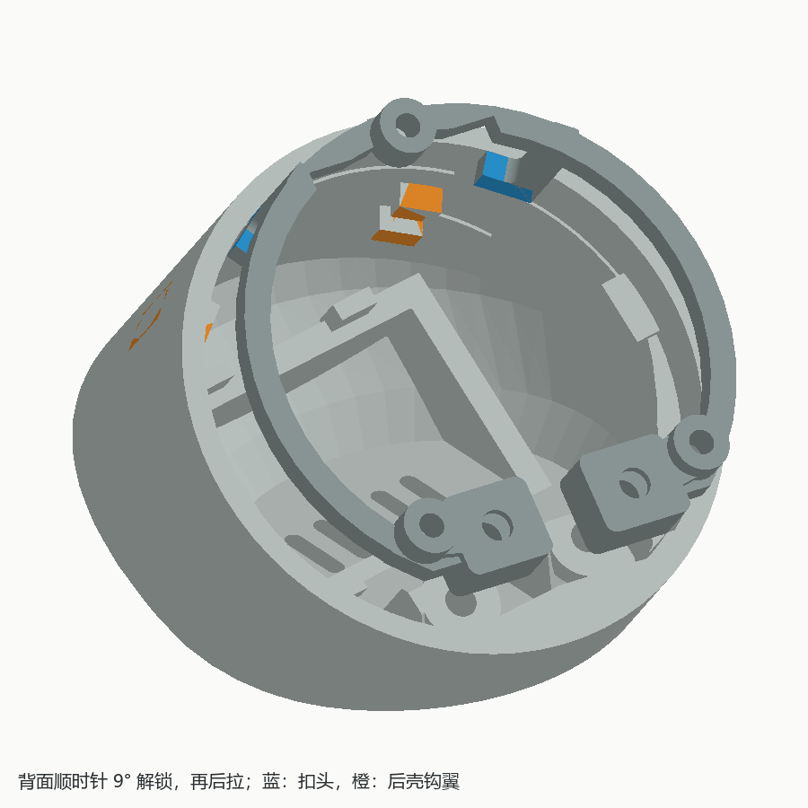

| 打印件 | 功能与连接 |
| --- | --- |
| `mount_carrier.stl` 承托架 | 模块背面三个原厂螺丝位固定；环宽 2.4 mm，增加宽筋和圆角螺母座；中央开敞 |
| `rear_cover.stl` 后壳 | 上侧双旋扣及左右承压垫定位，两颗 M3×6 螺丝锁紧；底部工具井、扬声器一体胶粘框及五条声孔 |

不采用弹性卡扣。上侧两处旋扣承受直接后拉，左右承压垫限定轴向位置，下侧两颗螺丝锁紧并限制误旋转。原厂三个固定孔不变；锁盖螺丝各向中央移动 2 mm，让扩大的工具井避开完整底环。保留下缘加厚过渡。

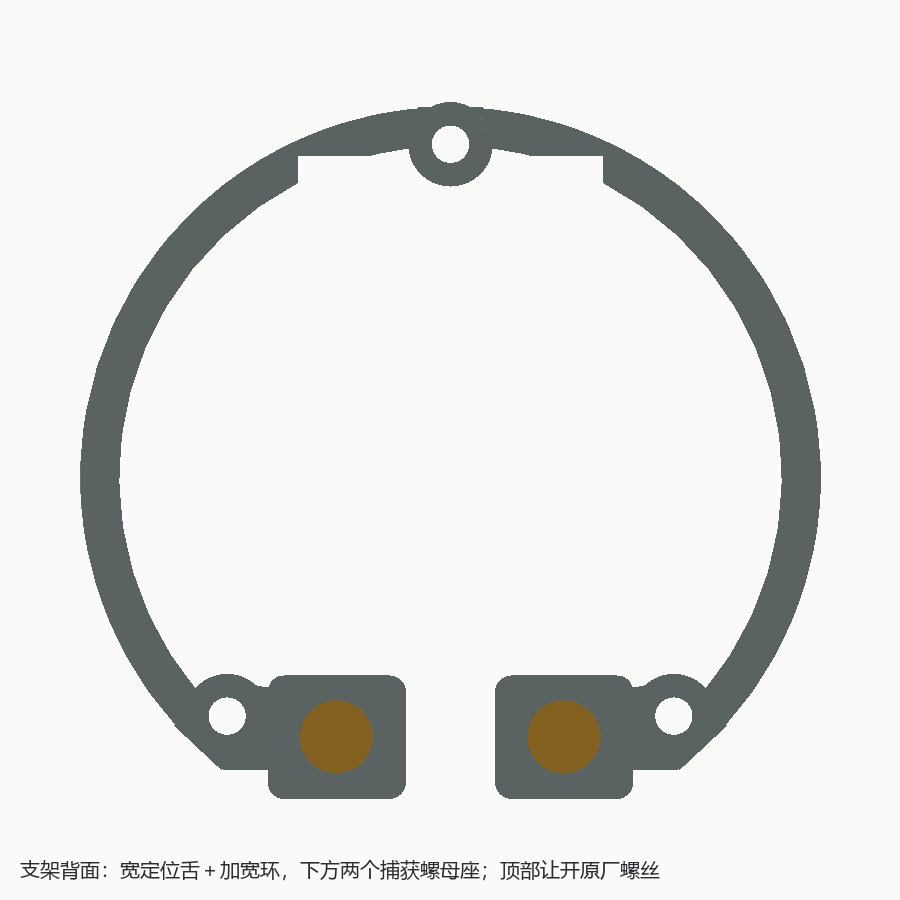
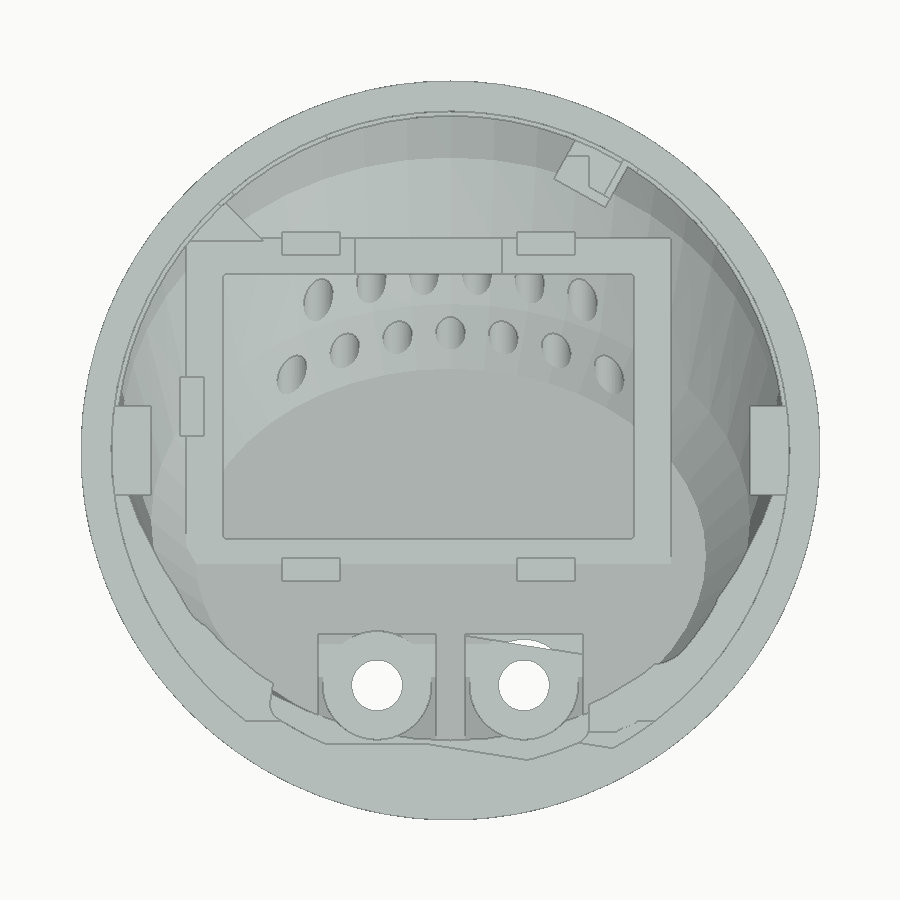
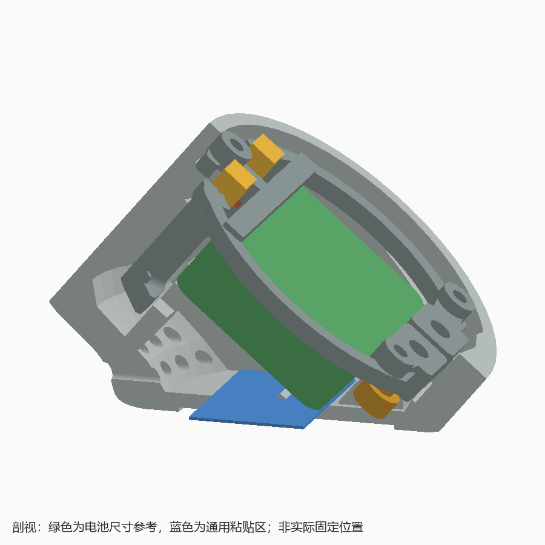

## 装配与拆卸

1. 打印承托架、后壳两件，清理支撑。本次直接采用 Ø3.8 mm 热熔底孔，不生成螺母公差试印件；原有旋扣及喇叭局部辅助样件仅存本地 `archive/fit_samples/`，不是额外整机部件。
2. 准备两颗 **M3×3×4 热熔螺母：M3 内牙、长 3 mm、滚花最大外径 4 mm**。从承托架背面沿螺丝轴线热熔压入，端面齐平；先热熔并冷却，再安装开发板及电池。底孔 Ø3.8 mm、深 3.4 mm，入口 0.3 mm 导角，前方 Ø3.3 mm 孔供螺丝尾端避空；取消六角袋和侧插槽。名义径向干涉 0.1 mm，须通过加热熔入，不能冷压硬塞；实物热熔及抗拔强度尚未验证。
3. 用原模块三个螺丝位固定承托架。孔中心 `(0,20.5)`、`(±13.75,−14.7)` mm，通孔 Ø2.3 mm 为初始值；替换螺丝必须与原件同牙型，保持原有旋入深度，只增加支架占用长度。原厂螺丝规格、头部大小和有效深度仍需实物核对。
4. 接好电池和扬声器的两个 2P 插头，整理线束，再固定内部元件。电池参考为 36×26×8 mm、R3；通用粘贴区只是空间参考，不是专用电池仓。扬声器为 30×20×7 mm；清洁硬边后，在四角贴 L 形双面胶，对准定位墙贴入后壳。不要将胶带跨过振膜；出线短边朝无挡墙的一端，沿参考通道接线并留出开盖余量，详见下节。
5. 从背面看，将后壳相对最终位置顺时针偏转 9°，沿屏幕法线套入，再逆时针回转至承压垫贴合。使用两颗 **M3×6 内六角圆柱头螺丝**，头部按 Ø5.5×3 mm 建模，从底部凹区的 Ø6.2 mm 工具井装入，穿过后盖 Ø3.4 mm 通孔；用直杆 2.5 mm 内六角扳手交替轻拧。螺丝不加垫片，名义啮合 3 mm，尾端伸出螺母 0.5 mm；不要用长螺丝替代而顶到模块。
6. 拆卸时托住模块并抬起设备，取出两颗 M3 螺丝，从背面看顺时针旋转 9°解扣，再沿屏幕后法线拉开后壳。螺丝可脱落，注意收好；不要从玻璃边缘撬，不需要拆原厂三颗螺丝。线束应留足打开后壳的维护余量。

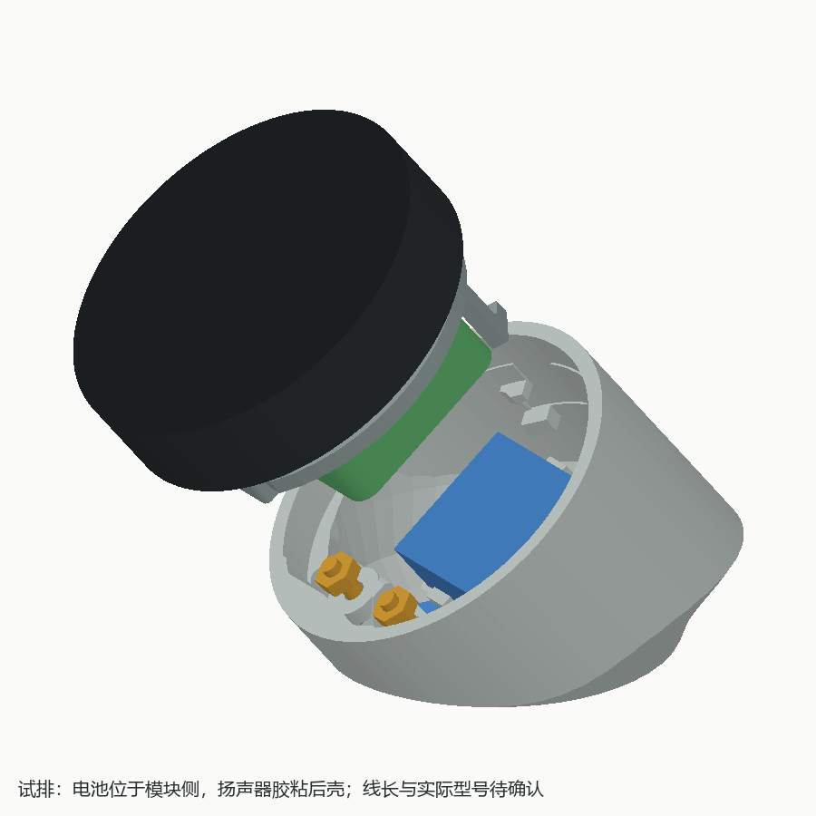
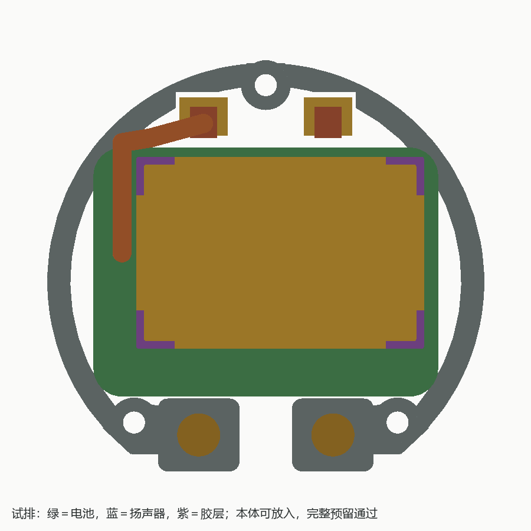
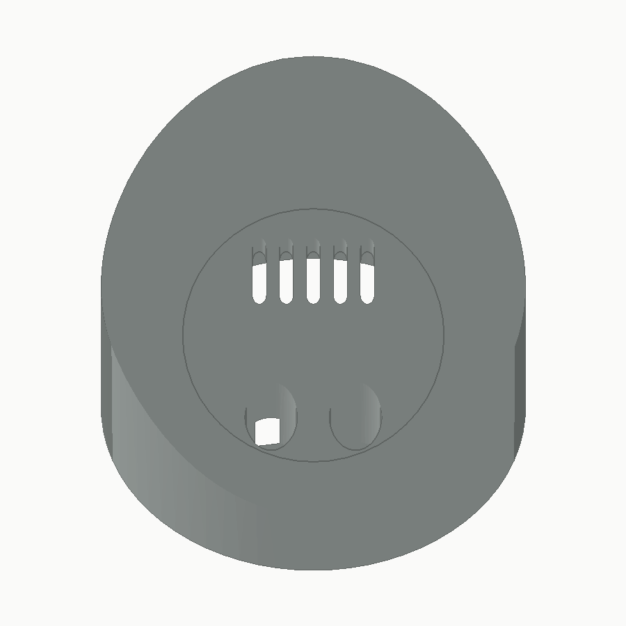

## 电池与扬声器安装

扬声器总外形 **30×20×7 mm**，长边横向，30×20 mm 面出音，20 mm 短边侧出线。电池保留 36×26×8 mm、R3 的参考占位，不新建专用电池仓；电池固定面及胶层未建模，安装方式仍需实物确认。

用户确认出音面四边中部的硬边只有约 1 mm，四角最大约 4 mm。胶层采用 **四角局部 L 形**，各臂长 4 mm、宽 0.8 mm、厚暂按 0.8 mm。不将最大角宽解释为完整 4×4 mm 方形贴胶区，也不沿用旧整圈 1.5 mm 胶带。四块胶层背面全部由一体平整框承托；实际裁胶与角部形状仍需试印核对。

两条长边各设两段定位墙，非出线短边设一段，共五段。定位墙厚 1.6 mm，与喇叭单边间隙 0.3 mm，沿喇叭侧面伸入约 2 mm；定位限制侧移和转动，胶带保持轴向贴合，不依靠弹性卡扣。出线端保持开放，拆卸时先拆后壳并断线，沿侧边逐步剥离胶层，不能撬压振膜。

除定位配合区外，周边保留 1 mm，振膜前方至少留 1 mm；短边整面另留 3 mm 接线区。参考走线通道按直径 2 mm 的线束建模并接入原有插头收线区，分别检查电池、壳体、承托架和紧固件的避让。线束实际直径、焊点位置、弯曲半径和维护线长未知；参考通道通过不代表真实线束寿命已验证。

出音格栅为 **5 条 1.6×6 mm 圆头孔，孔间筋 1.6 mm**。孔组在振膜区域内偏移，使声道穿过后壳、避开胶区及完整底环，不用大面积开孔削弱壳体。孔面积和朝向尚需实物试听。

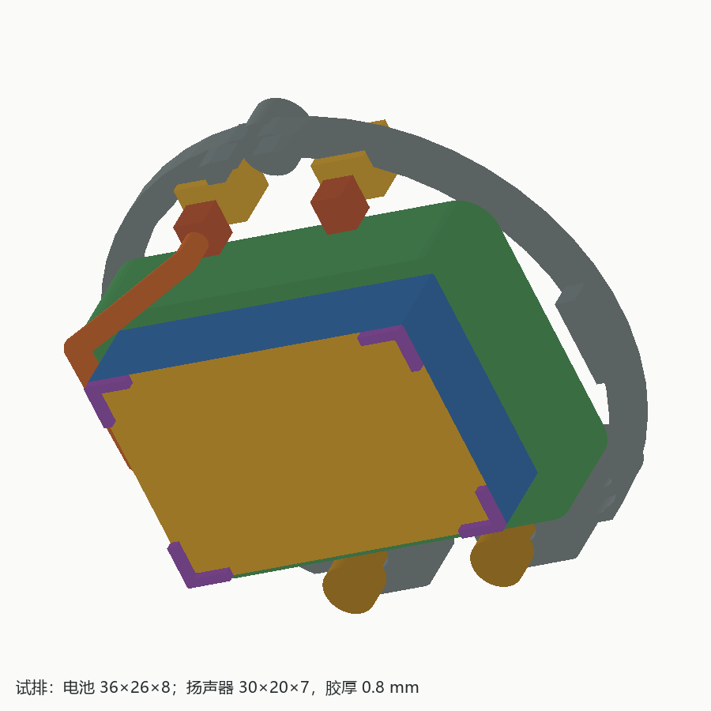
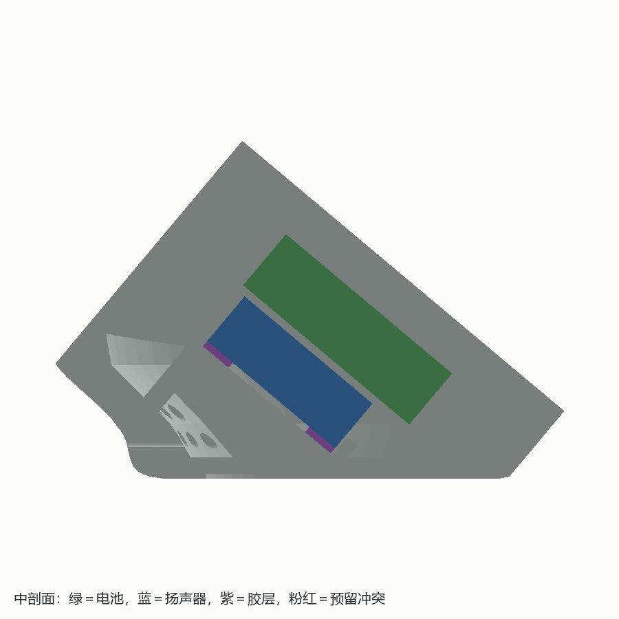
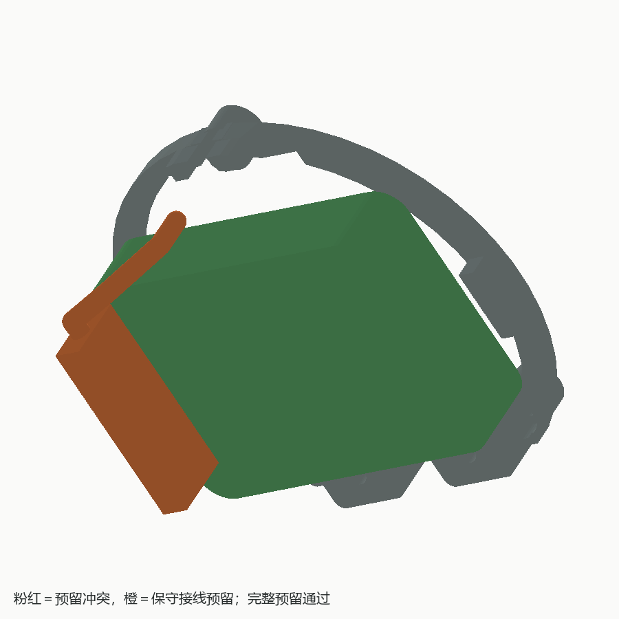
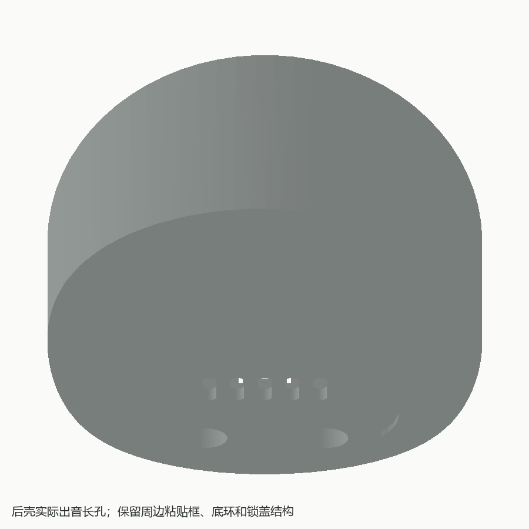
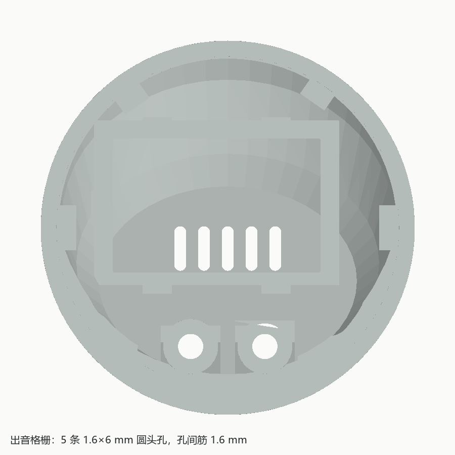

`stand.py` 顶部集中定义参数，单位 mm、角度单位度；不要直接改导出的网格或参考体。

| 参数 | 当前值与用途 |
| --- | --- |
| `LOCK_INSERT_LENGTH / LOCK_INSERT_OD / LOCK_INSERT_BORE / LOCK_INSERT_DEPTH` | 3 / 4 / 3.8 / 3.4，热熔螺母长度、外径、底孔直径及深度 |
| `LOCK_SCREW_LENGTH / LOCK_CLEARANCE_R / LOCK_TOOL_R` | 6 / 1.7 / 3.1，M3 螺丝长度、后盖过孔半径及工具井半径 |
| `HOOK_ANGLES / HOOK_RELEASE_DEG` | 55°、125.5° / 9°，两扣位置及背面顺时针解锁角 |
| `HOOK_ROOT_T / HOOK_FILLET_R / HOOK_CLEARANCE` | 2.4 / 1.0 / 0.30，根厚、补料圆角及配合间隙 |
| `HOOK_AXIAL_OFFSET` | 3.8，扣头沿模块背向的轴向偏移 |
| `BATTERY_W / BATTERY_H / BATTERY_T` | 36 / 26 / 8，电池外包尺寸 |
| `BATTERY_OFFSET_X / BATTERY_OFFSET_S / BATTERY_FRONT_N` | 0 / 1 / 17.6，电池位置 |
| `SPEAKER_W / SPEAKER_H / SPEAKER_THICKNESS` | 30 / 20 / 7，完整喇叭外包尺寸 |
| `SPEAKER_CORNER_R` | 0.2，未知实物圆角，近似矩形保守占位 |
| `SPEAKER_OFFSET_X / SPEAKER_OFFSET_S / SPEAKER_FRONT_N` | −1.5 / 3 / 33.5，振膜面中心 |
| `SPEAKER_TILT_DEG` | 0，与屏幕平行 |
| `SPEAKER_HARD_EDGE` | 1，边中部硬边宽度 |
| `SPEAKER_TAPE_T / SPEAKER_TAPE_RING_W / SPEAKER_TAPE_CORNER_LENGTH` | 0.8 / 0.8 / 4，胶厚、L 形胶臂宽及臂长；不是整圈胶 |
| `SPEAKER_LOCATOR_GAP / SPEAKER_LOCATOR_T` | 0.3 / 1.6，定位间隙及墙厚 |
| `SPEAKER_FRONT_GAP / SPEAKER_WIRE_GAP / SPEAKER_SIDE_GAP` | 1 / 3 / 1，振膜、短边出线及普通周边预留 |
| `SPEAKER_CABLE_DIAMETER` | 2，假定线束直径，修改后须重新验证通道 |
| `SPEAKER_SLOT_COUNT / SPEAKER_SLOT_W / SPEAKER_SLOT_H / SPEAKER_SLOT_WEB` | 5 / 1.6 / 6 / 1.6，声孔数量、宽、长及筋宽 |
| `SPEAKER_SLOT_OFFSET_X / SPEAKER_SLOT_OFFSET_S` | 1.5 / −5.8，声孔相对振膜中心偏移 |
| `SHELL_DEPTH_EXTENSION / SHELL_REAR_BULGE` | 4 / 8，模块轴向移位及后部曲线扩展参数，不等于外形增加量 |

坐标 `x` 为屏幕横向，`s` 沿屏幕向上，`n` 从屏幕正面指向背面。喇叭位置、五段定位、胶区、声孔随尺寸参数生成；走线折点集中在建模段，应随尺寸和端子位置调整。尺寸变化后必须检查 `validation.json` 中本体、完整包络、走线、声孔和旋转及后拉开合位置，不自动缩小实物尺寸来通过验证。

FreeCAD 内部参考体默认隐藏。隐藏 `Rear_Cover` 和 `Module_Reference` 后，可显示 `Battery_Reference`、`Speaker_Reference`、胶层、空气间隙和 `Speaker_Wire_Route_Reference` 检查布局。`speaker_fitted=false` 表示尚未实物装配，并不等于几何检查失败。

## 尺寸、空间与打印

- 模块参考外形 Ø51×12.1 mm，背面最低点距桌面约 8.16 mm（原 5.1 mm 加竖直抬高约 3.06 mm）；参考资料在 `reference/`，尺寸、原厂外壳凸起及接口仍需对实物核对。
- 两颗锁盖螺丝轴线为模块坐标 `(±5,−16)` mm，螺丝头承压面 n=21.5 mm。热熔螺母背面齐平于 n=19 mm，长度 3 mm；母座连接至原厂下方固定座，后盖承压座由底板上的筋支撑，保留电池参考占位。
- 底面外轮廓 41×40 mm 椭圆、中心后移 14 mm，中央浅凹 31×30 mm、深 0.6 mm，名义 5 mm 接触带保持完整。中央底板有两个维护工具孔；螺丝头最低点高于凹区底面，不接触桌面。
- 前口下缘的加厚过渡保留，普通内腔圆柱段名义壁厚 2.4 mm、安装让位区 2.1 mm；没有原卡扣盲槽。定位槽、紧固孔、工具井、胶粘框和格栅作为功能结构单独检查，不能用普通壁厚采样结果代表这些区域。普通壁厚结果见当前报告，格栅孔间筋名义宽 1.6 mm，两者含义不同。
- 内腔采用分段直线过渡，下缘内腔前侧局部后退 1.2 mm，避免平滑插值与安装让位相交产生窄片；外侧保持平滑曲线。壁厚仍按最终网格检查，不用截面参数差代替真实壁厚。
- 后壳外形约 50.4×61.0×40.5 mm。内部为连通空腔，旋扣、承压垫和锁紧座占用少量空间；当前净容积、壁厚采样与稳定性估算以 `output/validation.json` 为准。尚未进行实物载荷、触屏推力或反复拆装寿命试验。
- 建议 PETG、0.4 mm 喷嘴、0.2 mm 层高、4 道壁。后壳底面朝下；承托架 STL 已平放。承托架扣头、螺母座及后壳钩翼、锁紧座存在悬空区域，两件均需可移除支撑，参考设置为普通自动支撑、30°阈值及 5 mm 外沿（brim）。不要启用“仅接触热床支撑”而漏掉内侧悬空处。清理旋扣导槽、热熔孔和螺丝承压面后再试装；实际材料的支撑间距及拆除难度需要先打印试装件确认。

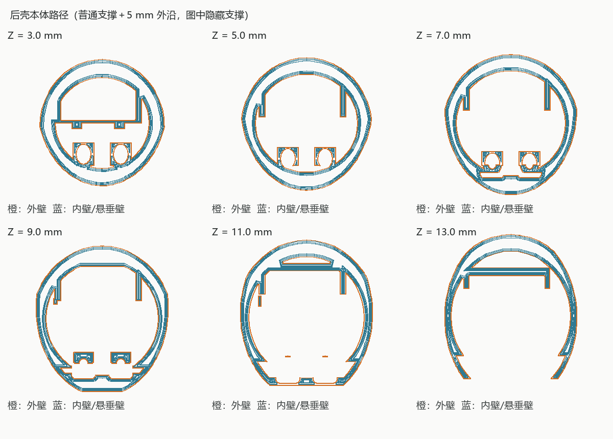
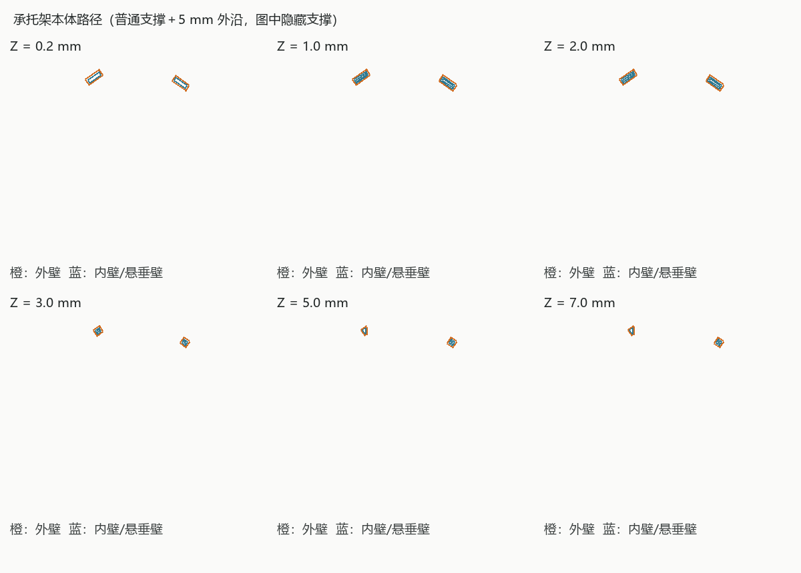

## 生成与验证

`stand.py` 是唯一建模源；`render_previews.py` 只渲染建模缓存；`verify_print.py` 调用本机 Bambu Studio 作参考切片，`print_geometry.py` 按三个高度的 STL 截面校准自动排版，只做刚体旋转和平移、不缩放，并检查实际挤出对功能见证点的覆盖。

```powershell
# 以下命令在 projects/esp32-pebble-stand/ 目录执行。
& 'D:\Program\FreeCAD 1.1\bin\freecadcmd.exe' -u archive/repair_user.cfg -s archive/repair_system.cfg stand.py
py -3.10 render_previews.py
py -3.10 verify_print.py
py -3.10 verify_print.py --part mount_carrier
py -3.10 -m unittest test_print_geometry
```

默认切片程序为 `C:\Program Files\Bambu Studio\bambu-studio.exe`，可用 `--slicer` 指定安装位置。验证使用 Prusa MK3S 0.4 mm 参考配置、Generic PETG、0.2 mm 层高、4 道壁和经典墙生成器；两件均加普通自动支撑和 5 mm 外沿。两件均重新切片并检查本体层连续性、下缘路径及支撑生成；后壳额外核对五段定位墙、四角胶面和四条格栅筋的实体见证点，覆盖率要求至少 95%。报告记录实际层数、顶部缺失和功能检查，不将采样覆盖率当成全模型打印保证。参考配置不是用户实际机型配置，G-code 仅存本地归档；两份报告通过 SHA-256 绑定对应 STL。

正式交付均在 `output/`，使用固定名称。**实际只打印两件**：`mount_carrier.stl` 为承托架，`rear_cover.stl` 为后壳；STL 已按推荐方向落床。`stand.step` 用于查看两打印件的装配位置，装配姿态不等于打印姿态；`stand.FCStd` 用于完整工程检查，内部参考体不打印。预览及验证报告同时更新。STEP 只有两个打印实体；FCStd 还保留模块、电池、扬声器、胶层、安装预留、插头、走线和紧固件参考体，默认隐藏内部参考。生成后可调用源中的 `configure_display(doc)` 设置 GUI 可见性。

建模检查包含两件有效单实体、封闭网格、STEP 重导入两实体、装配干涉、热熔工具轴向入口、原厂螺丝和锁盖工具通路、左右承压垫、双旋扣防脱及连续旋转／后拉行程、正面投影、前口密集网格壁厚及底环方位/宽度。切片检查区分本体层和支撑专用层，检查本体层连续挤出及非顶层壳壁路径，以及后壳下缘中央和两侧的 62 条逐层检查截线。采样不等同于数学全局最小壁厚，打印松紧、承载及寿命仍需实打确认。

更换模型后，请先删除切片工程里的旧对象，再重新导入 STL，使用自己的打印机与材料配置重新切片。

几何和参考切片结果见 `validation.json`、`print_validation.json` 和 `carrier_print_validation.json`。旋扣按真实 STL 的完整承力截面核对 ≥95% 轮廓覆盖，截面须有至少四条墙／实心填充交叉路径，或 ≥95% 实心挤出覆盖；斜面尖端和不足 1.6 mm 的非完整截面单独计数，不冒充承力截面。支撑和外沿不能替代本体材料。新增结构的连续悬空检查覆盖承托架全高、后壳底板以上区域；原有底板首 2.6 mm 的结果另记 `base_transition_runs`，仍需试印核对起始扩展，不能把上方检查通过当成底板打印保证。参考外沿宽 5 mm、与物体间距 0，打印后需修边。

几何和切片通过不等于实物载荷或寿命认证，仍需试印核对松紧、槽内支撑清理、触屏推力、粘接及线束维护余量。

生成候选时可设置 `S3_OUTPUT_DIR`、`S3_PREVIEW_DIR`、`S3_FIT_DIR` 和 `S3_PRINT_CACHE_DIR` 隔离输出、辅助网格、试印样件和切片缓存；候选通过后同步正式输出，并刷新、保存用户打开的同一 S3 文档。
