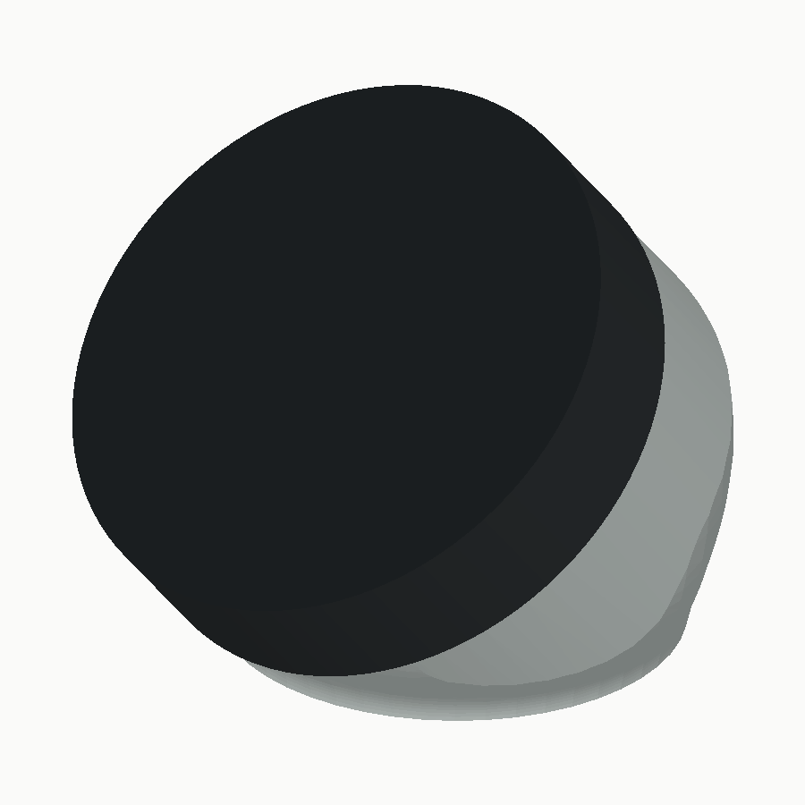
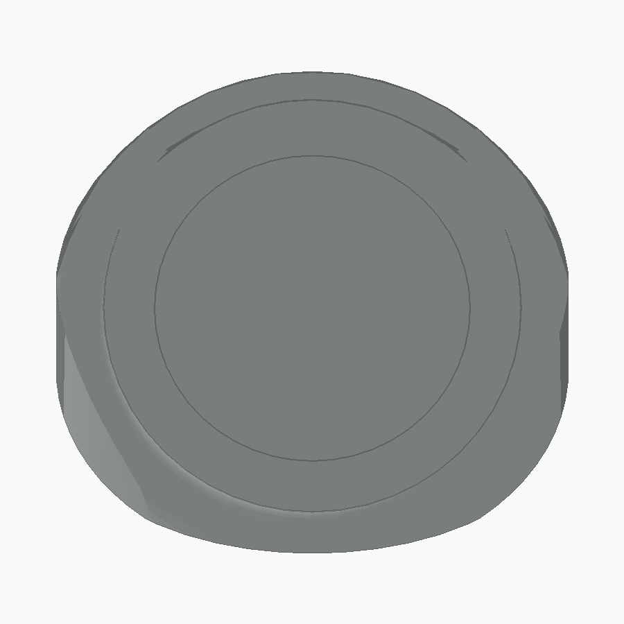
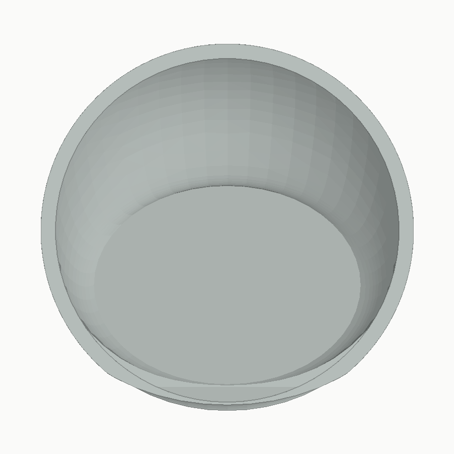
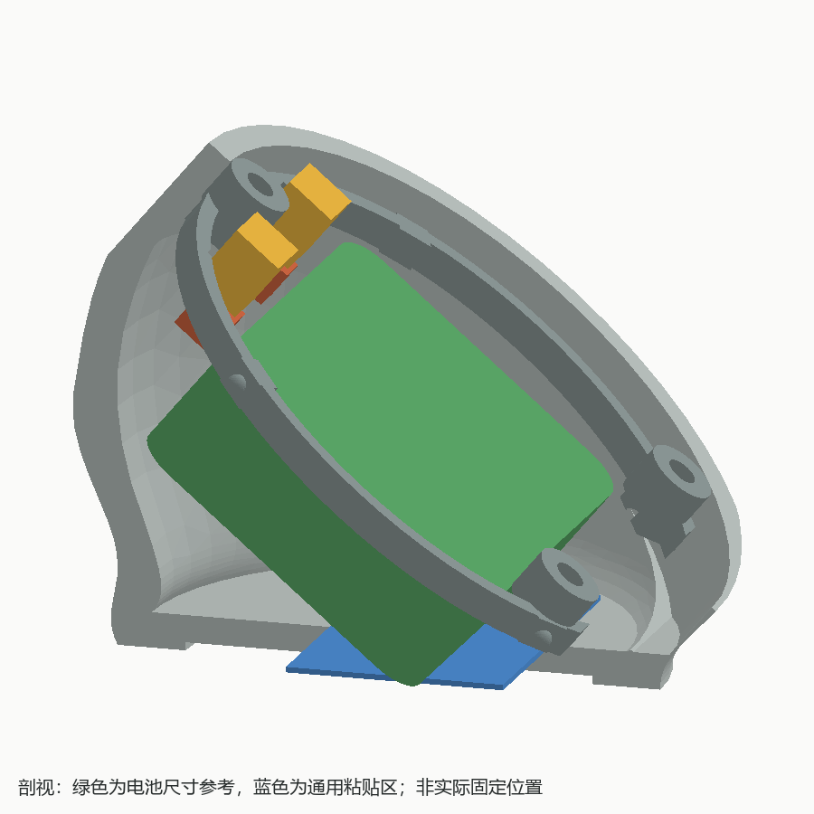
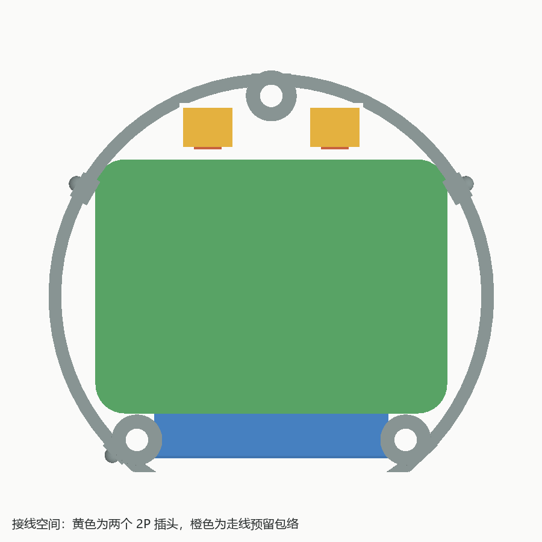
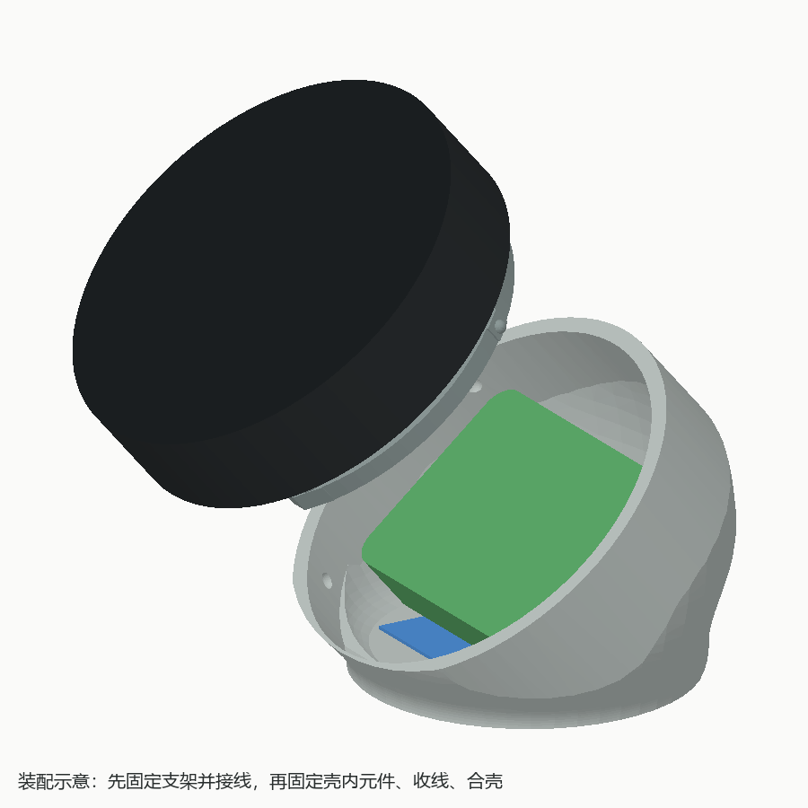

# ESP32-S3-Touch-AMOLED-1.75-B 鹅卵石桌面底座

适配[微雪 ESP32-S3-Touch-AMOLED-1.75-B](https://www.waveshare.net/shop/ESP32-S3-Touch-AMOLED-1.75-B.htm)成品模块。模块已有外壳和正面玻璃；本项目只打印其背后的安装支架与桌面后壳。





## 当前结构

- 屏幕相对水平面 **40°**。模块正面和带 USB-C、按键的侧边保持原样外露。
- 沿屏幕法线正视时只显示屏幕，整个后壳、支架和底面均藏在 Ø51 mm 模块后方。整壳投影限制为 Ø50.4 mm，单边保留 0.3 mm 遮挡余量；轴向接缝另留 0.3 mm。斜侧面仍可看到后壳。
- 开口周边支架借用模块背面三个原厂螺丝位；取消中央圆形电池贴板和下方无用弧段，支架下缘裁至模块平面坐标 s≥−18 mm。顶部两个 2P 插头、插入方向和收线空间均有参考体。
- 后壳从模块背面直接承托，靠支架上的三个弹性凸点与壳内盲槽卡合。外表没有螺丝通孔。
- 后壳底板完整封闭。底面中央浅凹 0.6 mm，外侧形成连续 360°、约 5 mm 宽的水平接触带。
- 两件 STL 已分别摆成打印姿态；STEP 和 FCStd 保留装配姿态。原有的旋转螺纹和电池底部取放孔已取消。
- 内部为随外形挖出的连通空腔，不设电池专用仓或分隔板。扣除支架后净空间约 **29.7 cm³**；电池和扬声器可通过可拆魔术贴固定在内壁或底板。
- **扬声器尚未选型**：本轮仅预留通用空间，不设置专用扬声器座和出音孔。选型后需确定实际摆放、固定方式和出音孔，当前不是完整的扬声器适配结果。






## 主要尺寸

| 项目 | 当前值 |
| --- | --- |
| 模块参考外形 | Ø51 × 12.1 mm，含原厂外壳 |
| 模块背面最低点 | 距桌面 5.1 mm |
| 屏幕倾角 | 相对水平面 40° |
| 前口及整壳正面投影上限 | Ø50.4 mm，轴向接缝 0.3 mm |
| 底面外接触椭圆 | 41 × 40 mm，中心后移 14 mm |
| 底面中央浅凹 | 31 × 30 mm，深 0.6 mm |
| 后壳底板最薄厚度 | 2.0 mm（浅凹中心处） |
| 电池参考 | 36 × 26 × 8 mm，R3 四角；尺寸尚待实物确认 |
| 通用粘贴区参考 | 底板上方 24 × 16 mm，不是电池专用仓 |
| 空腔体积 | 30.24 cm³；扣除支架后 29.70 cm³ |
| 空腔包围尺寸 | 约 46.4 × 43.8 × 33.6 mm，世界坐标；不代表可放入同尺寸长方体 |
| 螺丝位（模块平面坐标） | (0, 20.50)、(±13.75, −14.70) mm |
| 壳体表面包围尺寸 | 约 50.4 × 47.4 × 37.5 mm，世界坐标 |
| 卡扣 | 模块平面角度 30° / 150° / 225°，凸点中心半径 23 mm |

以上模块尺寸沿用项目参考图；螺丝牙型、实物凸起及电池线出口仍须实物核对。支架 M2 通孔是初始值，替换螺丝应与原件**同牙型**，并保持原有旋入深度，只增加支架占用的长度。

## 文件与运行

| 文件 | 用途 |
| --- | --- |
| `stand.py` | 唯一参数化建模源文件 |
| `render_previews.py` | 从 STL 生成预览，不参与建模；需 Python 和 Pillow |
| `output/mount_carrier.stl` | 支架，已平放 |
| `output/rear_cover.stl` | 封闭后壳，底面已朝下 |
| `output/stand.step` | 两个打印件的装配位置 |
| `output/stand.FCStd` | 打印件、模块和电池参考体 |
| `output/preview_*.png` | 静态模型预览 |
| `output/validation.json` | 本轮几何验证的尺寸、空腔、壁厚采样与稳定性数据 |
| `reference/` | 模块参考图 |

在项目目录运行：

```powershell
& "D:\Program\FreeCAD 1.1\bin\freecadcmd.exe" stand.py
py -3.10 render_previews.py
```

或在 FreeCAD GUI 的 Python 控制台运行：

```python
exec(open(r"stand.py", encoding="utf-8").read())
```

导出覆盖 `output/` 中同名文件；预览由第二条命令单独更新。脚本在导出前检查实体有效性、接触带、干涉和重心。

## 装配与打印

1. 实测原厂螺丝牙型与长度。逐颗换成同牙型、增加支架厚度的螺丝，把薄支架固定在模块背面；不可让螺丝深入原厂外壳内部。
2. 后壳保持打开，先将电池线、扬声器线插入模块原有的两个 2P 插座。FCStd 中可分别显示 `Connector_*`、`Insertion_*`、`Wire_*` 参考体，查看插头和预留空间。
3. 按实际元件外形选择壳内摆放位置，用可拆魔术贴固定，保留插头后方收线空间；不要压住插座或把线夹在接缝和卡扣上。绿色电池参考体只用于尺寸检查，并非已确定的固定位置；蓝色区域示意可粘贴的底板位置。
4. 收好线束，对齐三个卡扣后沿模块轴线压合。拆卸时从接缝周围均匀撬开，避免只拉一个卡扣。扬声器选型后需补充出音孔，当前封闭外壳不用于评价扬声器音效。
5. 两件建议 PETG、0.2 mm 层高、0.4 mm 喷嘴、4 圈壁厚。后壳底面朝下，支架按 STL 的平放姿态打印。空腔顶部存在约 21.4 mm² 的高处大角度下表面，需在切片中检查桥接，并视打印机能力添加可从前口移除的局部支撑；先试装螺丝与卡扣，再固定元件。

## 已验证与待实测

- FreeCAD 1.1.4：支架、后壳各 `valid=True` 且各只有 1 个实体；两件 STL 均封闭。
- 后壳真实表面最低点 `z=0`；接触带 72/72 方位采样为实体，浅凹中心下方仍有材料。修剪曲面的 BRep 控制点包围盒会偏大，报告尺寸取自表面网格。
- 整壳及支架的正面投影最大半径 25.2 mm，后壳在约束圆柱之外的实体体积为 0；前口截线最大半径也为 25.2 mm。空腔为 1 个连通实体。
- 圆柱约束段普通壁厚 2 mm；常规放样侧壁 29 个采样点的最小法向距离约 2.14 mm，此结果不等同于全表面最小壁厚。三个卡扣球形盲槽距外表面最小剩余壁厚 1.2 mm。
- 支架/后壳、模块/后壳、电池/两打印件、两个 2P 插头/两打印件的体积相交均为 0。插头插入包络和收线参考体也已检查。
- 合壳行程 0.5 / 1 / 2 / 4 / 8 / 12 mm 的插头、收线包络及非弹性支架区域均无干涉；卡扣端部划为弹性区，不把其压合接触误判为刚性碰撞，也未据此宣称弹性寿命通过。
- 以模块 50 g、电池 15 g、PETG 1.27 g/cm³ 估算，总重约 78.8 g；72 个方向的最小理论倾覆角约 34.3°，尚不包含未知扬声器重量。实际桌面稳定性以最终布局和打印件为准。
- 打印姿态的高处大角度悬垂：支架 0 mm²，后壳约 21.4 mm²；该数值只衡量三角面方向，不替代切片检查。
- **尚待实测**：原厂螺丝规格与安全旋入深度、成品外壳公差、插头线束弯曲空间、PETG 卡扣松紧及反复拆装寿命。
