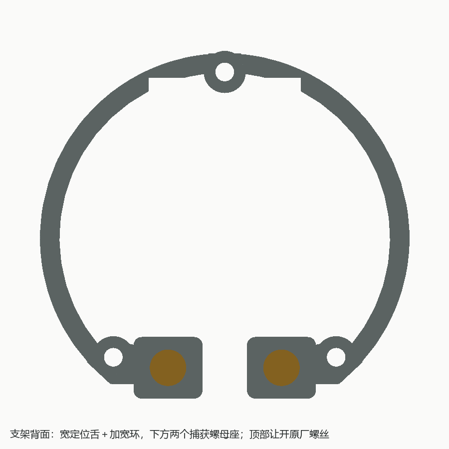
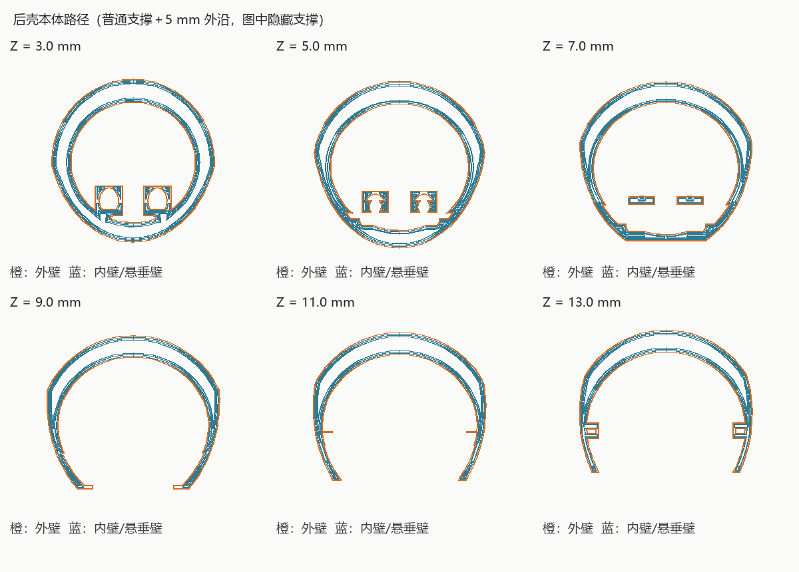
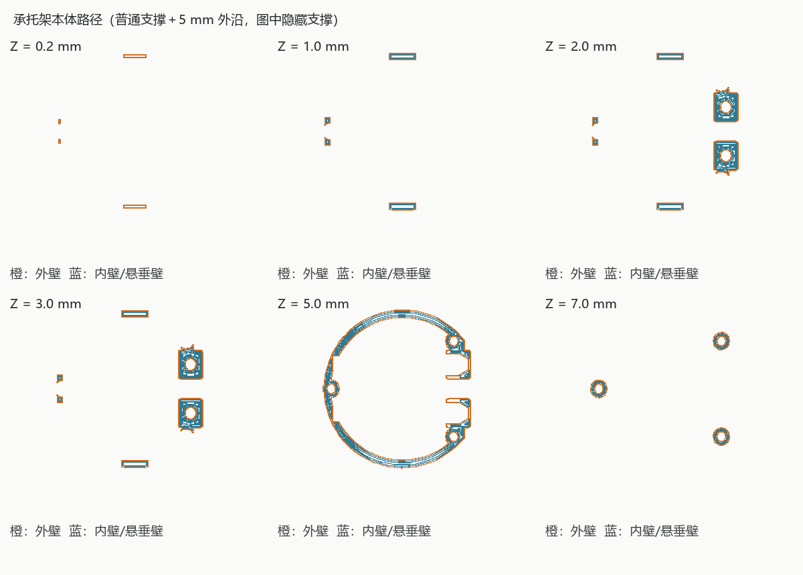

# ESP32-S3-Touch-AMOLED-1.75-B 鹅卵石桌面底座

适配[微雪 ESP32-S3-Touch-AMOLED-1.75-B](https://www.waveshare.net/shop/ESP32-S3-Touch-AMOLED-1.75-B.htm)成品模块。保留原厂外壳与玻璃，屏幕相对桌面 40°，打印件正面投影限制为 Ø50.4 mm，隐藏在 Ø51 mm 模块后方。


## 两件式固定结构

| 打印件 | 功能与连接 |
| --- | --- |
| `mount_carrier.stl` 承托架 | 模块背面三个原厂螺丝位固定；环宽 2.4 mm，增加宽筋和圆角螺母座；中央开敞 |
| `rear_cover.stl` 后壳 | 三处宽止口定位、端面承压，两颗 M2.5×8 螺丝锁紧；底部凹区留工具井 |

不采用弹性卡扣。三处定位舌名义宽 8 mm、轴向嵌合 3 mm、单边间隙 0.25 mm，入口有 0.6 mm 导向斜面；上下方向由顶部的分叉键和下方螺丝位置区分。顶部键加宽成两翼，让开原厂顶螺丝的直线操作通路；槽的内侧同时避让两个插头。

定位结构负责限制横向移动和转动，三处端面限定合盖位置，两颗螺丝提供轴向夹紧。不是靠两个小螺丝杆直接承受全部侧向载荷，也无需挤压小凸点才能合壳。




## 装配与拆卸

1. 先打印源脚本生成在 `archive/fit_samples/` 的 `nut_pocket.stl`、`guide_tongue.stl`、`guide_socket.stl`，检查本机公差。它们不属于整机打印件，也不提交 Git；重新生成工程即可得到。
2. 用两颗 **M2.5 六角螺母，对边 5 mm、厚 2 mm**，从承托架内侧滑入螺母袋。袋对边 5.2 mm、深 2.2 mm，入口宽 6.1 mm；入口需容纳六角螺母约 5.77 mm 的对角尺寸。袋侧壁名义最薄 1.2 mm，后方承压肩厚 2.2 mm。六角袋止转，承压肩承担锁紧力；开壳翻转时注意螺母可能从侧向入口滑出。
3. 用原模块三个螺丝位固定承托架。孔中心 `(0,20.5)`、`(±13.75,−14.7)` mm，通孔 Ø2.3 mm 为初始值；替换螺丝必须与原件同牙型，保持原有旋入深度，只增加支架占用长度。原厂螺丝规格、头部大小和有效深度仍需实物核对。
4. 接好电池和扬声器的两个 2P 插头，整理线束，再固定内部元件。电池参考为 36×26×8 mm、R3；通用粘贴区只是空间参考，不是专用电池仓。扬声器尚未选型，没有专用安装座和出音孔。
5. 对准三处止口，后壳沿屏幕法线直接套入，直到端面接触。使用两颗 **M2.5×8 内六角圆柱头螺丝**，头部按 Ø4.5×2.5 mm 建模，从底部凹区的 Ø5.3 mm 工具井装入；用直杆 2 mm 内六角扳手交替轻拧，无需另用扳手夹住螺母。螺丝不加垫片。
6. 拆卸时托住模块并抬起设备，取出两颗 M2.5 螺丝，再沿轴向拉开后壳。螺丝可脱落，注意收好；不要从玻璃边缘撬，不需要拆原厂三颗螺丝。线束应留足打开后壳的维护余量。


## 尺寸、空间与打印

- 模块参考外形 Ø51×12.1 mm，背面最低点距桌面 5.1 mm；参考资料在 `reference/`，尺寸、原厂外壳凸起及接口仍需对实物核对。
- 两颗锁盖螺丝轴线为模块坐标 `(±7,−16)` mm，螺丝头承压面 n=21.5 mm。螺母座连接至原厂下方固定座，后盖承压座由底板上的筋支撑，保留电池参考占位。
- 底面外轮廓 41×40 mm 椭圆、中心后移 14 mm，中央浅凹 31×30 mm、深 0.6 mm，名义 5 mm 接触带保持完整。中央底板有两个维护工具孔；螺丝头最低点高于凹区底面，不接触桌面。
- 前口下缘的加厚过渡保留，普通内腔圆柱段名义壁厚 2.4 mm、安装让位区 2.1 mm；没有原卡扣盲槽。定位槽、紧固孔和工具井作为功能结构单独检查，不能用普通壁厚采样结果代表这些区域。
- 外形约 50.4×50.7×37.5 mm。内部为连通空腔，新增止口和锁紧座占用少量空间；当前净容积、壁厚采样与稳定性估算以 `output/validation.json` 为准。尚未进行实物载荷、触屏推力或反复拆装寿命试验。
- 建议 PETG、0.4 mm 喷嘴、0.2 mm 层高、4 道壁。后壳底面朝下；承托架 STL 已平放。承托架定位舌、螺母座及后壳锁紧座存在悬空区域，两件均需可移除支撑，参考设置为普通自动支撑、30°阈值及 5 mm 外沿（brim）。不要启用“仅接触热床支撑”而漏掉内侧悬空处。清理定位槽、螺母袋和螺丝承压面后再试装；实际材料的支撑间距及拆除难度需要先打印试装件确认。




## 生成与验证

`stand.py` 是唯一建模源；`render_previews.py` 只渲染建模缓存；`verify_print.py` 调用本机 Bambu Studio 作参考切片。

```powershell
& 'D:\Program\FreeCAD 1.1\bin\freecadcmd.exe' -u archive/repair_user.cfg -s archive/repair_system.cfg stand.py
py -3.10 render_previews.py
py -3.10 verify_print.py
py -3.10 verify_print.py --part mount_carrier
```

默认切片程序为 `C:\Program Files\Bambu Studio\bambu-studio.exe`，可用 `--slicer` 指定安装位置。验证使用 Prusa MK3S 0.4 mm 参考配置、Generic PETG、0.2 mm 层高、4 道壁和经典墙生成器；两件均加普通自动支撑和 5 mm 外沿。后壳 186 个本体层、72 个支撑专用层，承托架 40 个本体层、13 个支撑专用层，均无切片警告。后壳曲面顶部约 0.24 mm 的窄尖端被切片器省略，属于本次参考切片的分辨率限制。这不是用户实际机型的打印配置，G-code 仅存本地归档。两份切片报告通过 SHA-256 绑定对应 STL。

正式交付为 `output/stand.FCStd`、`stand.step`、两个 STL、预览及验证报告，均使用固定名称。STEP 只有两个打印实体；FCStd 还保留模块、电池、插头、走线和紧固件参考体，默认隐藏内部参考。生成后可调用源中的 `configure_display(doc)` 设置 GUI 可见性。

建模检查包含两件有效单实体、封闭网格、STEP 重导入两实体、装配干涉、螺母滑入路径、原厂螺丝和锁盖工具通路、三个端面止挡、完整刚性合盖行程、正面投影、前口密集网格壁厚及底环方位/宽度。切片检查区分本体层和支撑专用层，检查本体层连续挤出及非顶层壳壁路径，以及后壳下缘中央和两侧的 62 条逐层检查截线。采样不等同于数学全局最小壁厚，打印松紧、承载及寿命仍需实打确认。

更换模型后，请先删除切片工程里的旧对象，再重新导入 STL，使用自己的打印机与材料配置重新切片。
