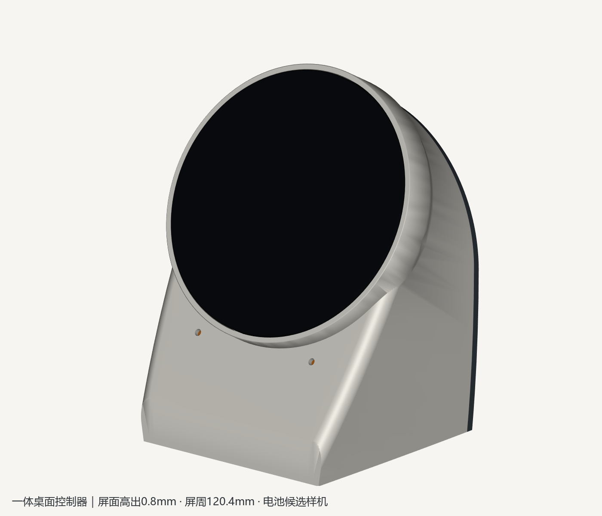
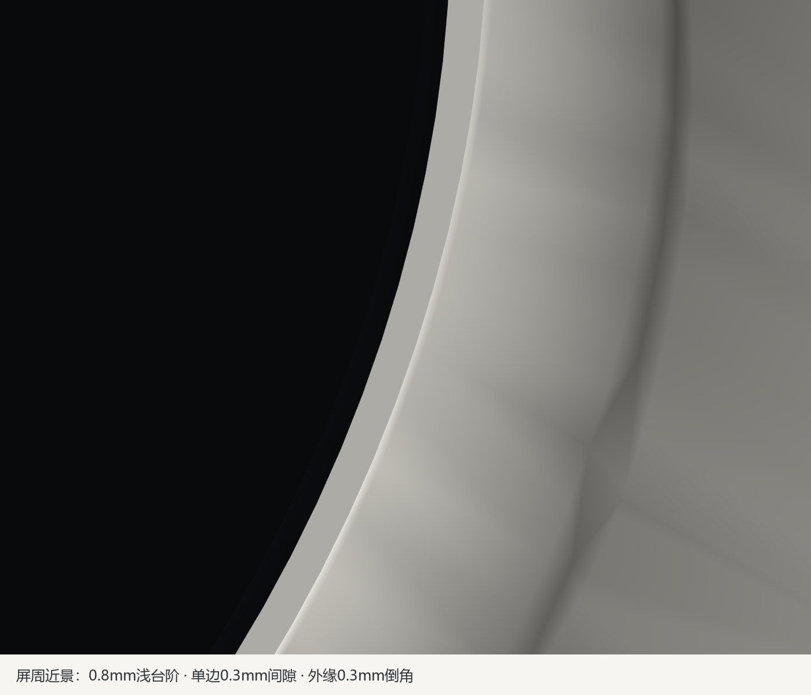
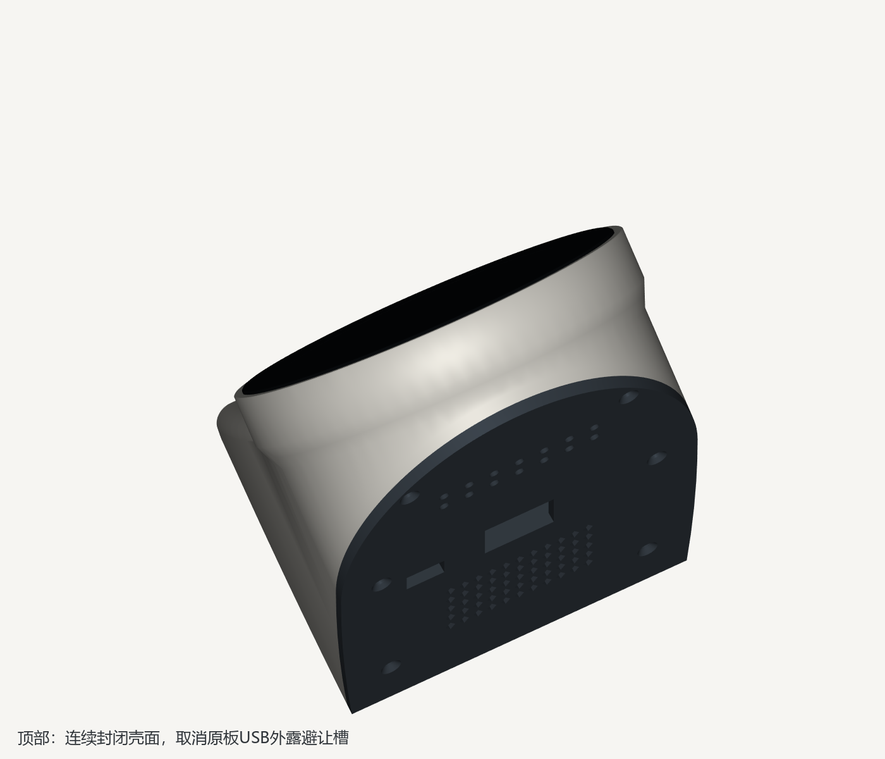
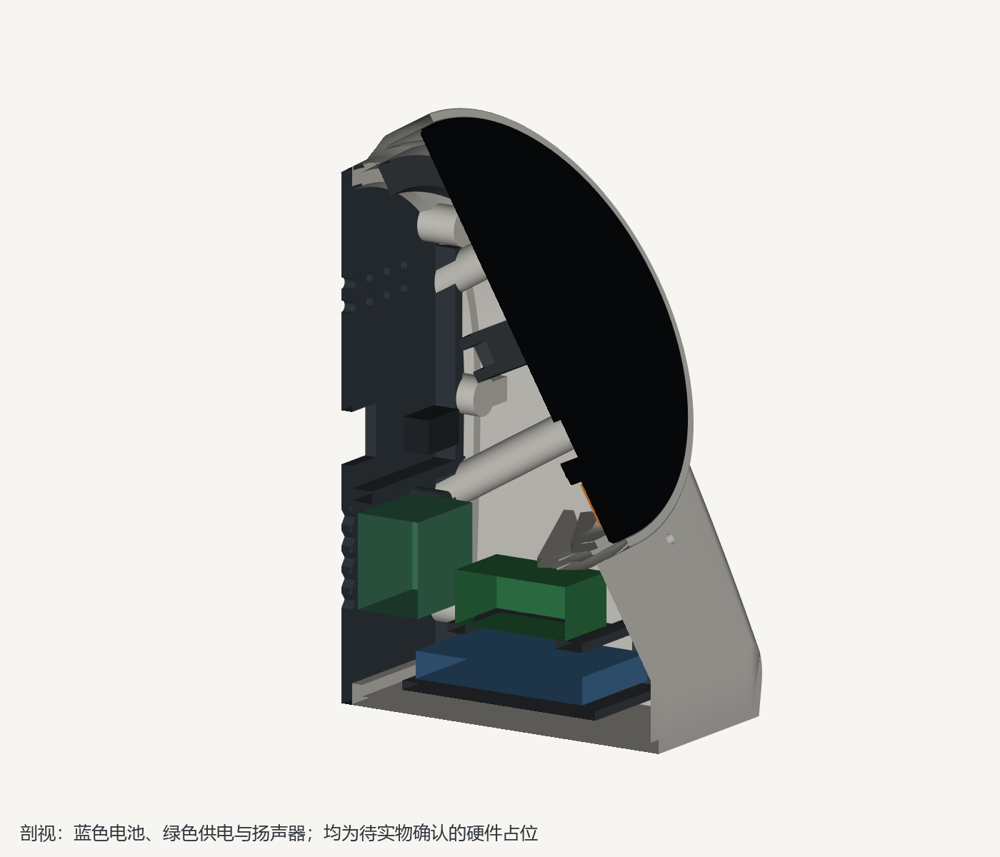
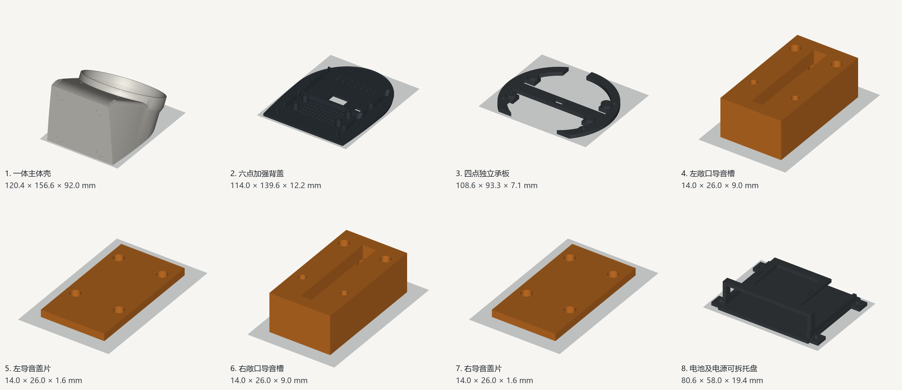
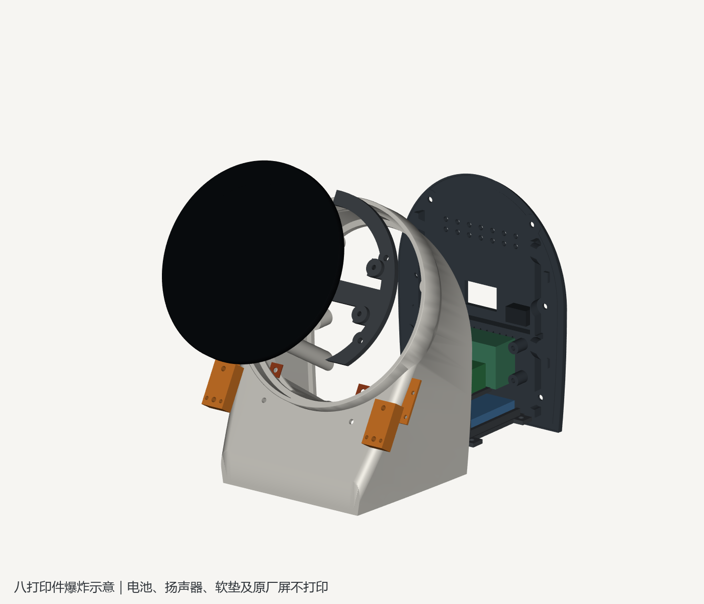

# P4 柔和一体桌面控制器

以桌面显示、触控为主，兼容双麦语音助手。原厂约Ø115 mm圆屏与桌面固定60°，暖白机身、深灰后盖；主壳一体包覆屏幕侧边，屏面高出周边0.8 mm，形成接近平齐的窄边收口，无独立压框或支架。

**当前交付为八件式工程候选，硬件未冻结，不是完成实物验证的成品。** 电池、供电模块、扬声器、USB延长座、开关及麦克风声孔都需实物核对；STL放在 `output/trials/`，`--release`拒绝正式放行。旧两件式项目保持独立。



## 尺寸与结构

整机参考包络约120.4×95.2×156.58 mm，不含突出桌面0.8 mm的软脚；最终以 `output/fit_validation.json` 为准。屏周内径115.6 mm、外径120.4 mm，单边间隙0.30 mm、壁厚2.4 mm，前端位于屏面后0.8 mm，外缘0.3 mm倒角；包覆至屏幕局部深度16.3 mm，再用8 mm锥形段接回原主体。下部原有圆角、机身及底部轮廓保留，底板2.6 mm。曲面与连接区仍需PETG试印，参数差不代表全局最薄壁证明。

本次修复屏壳大缝和顶部USB缺口：顶部恢复连续壳面，原屏、承板及孔位不移动。修复前后七个配套打印件几何相同，原厂模块位置相同，z=40 mm以下主壳双向差为0；对比见 `output/revision_validation.json`。仅需重打 `trials/main_body.stl`。




- 显示承板4 mm，四颗M3×8圆头螺丝配0.5 mm垫片独立固定；拆后盖不释放屏幕支承。
- 后盖3.2 mm，六颗M3×8沉头螺丝，内侧加强筋、四处局部定位及密封槽。十个连接点使用长3 mm、外径约4 mm的M3热熔螺母；名义孔径3.8 mm，先试片校准。
- 电池及电源托盘四颗M3×6固定，另四颗同规格热熔螺母，共14颗M3螺母。电池固定在电源平台下方，安装螺丝位于电芯包络之外。底部1 mm软垫、两条松弛织带保持电池，不靠拧紧托盘螺丝夹压电芯。
- 电池上方预留1.5 mm空间，侧向0.8 mm；这属于候选装配余量，不能替代所购电芯厂家对使用空间的要求。
- 主体内两对渐宽斜梁分别承托圆屏开口及新增锥形段下缘，托盘螺母座通过斜坡连到底板，适应后开口贴床的打印方向。斜梁最高52.4 mm、最低41 mm，避开电源包络与原厂模块；不作为线束固定点。
- 四个Ø10×0.8 mm脚垫浅槽，建议Ø9.8×1.6 mm软脚，贴好后机身离桌约0.8 mm。软脚、胶、密封垫、织带和硬件均不打印。



## 电池与声音

供电链路为：外接USB 5 V → 独立充放电模块输入 → 模块输出及电源开关 → P4供电USB口。外接USB入口在后盖22×14 mm预留区；开关窗口12×7 mm。均为**待所购面板件确认的安装预留**，尚无已验证的面板件固定座。调试时拆盖使用原板接口，不把两个电源输出直接并接。

电池候选为Adafruit 328，3.7 V、2500 mAh，官方60×50×7.3 mm；供电候选为DFRobot DFR0446 / MP2636，官方PCB35×30 mm，模型保守预留38×33×14 mm。模块高度、连接器与所用线材未实测。**模块原理图默认约2.53 A充电，超过该电池官方推荐的1.2 A上限，两者不能未经限流修改直接搭配。** 具体电阻、供电路径、温度检测与冻结条件见 [硬件选型说明](reference/hardware_selection.md)。

2500 mAh按3.7 V计9.25 Wh；暂按85%转换效率并保留20%能量，1小时目标对应平均负载不超过约6.29 W。这里只是预算，实际亮屏、联网功耗与续航尚未测量。

扬声器按8 Ω、2 W、PH2.0两针的独立音腔模块预留50×18×25 mm，位于后部、底面z=25 mm；背盖四个固定预留柱不表示已适配真实安装耳。出音区55个3×4 mm菱形孔，名义开孔330 mm²。选定实物后补齐转接、隔振和密封，不能让振膜或音腔直接接触电池。

左右导音件沿用局部坐标x=±30、s=−43、n=12.3 mm作为**待实测占位**；外口s=−61 mm。3×3 mm声道分别封闭，入口软垫0.8 mm、盖下开窗密封垫0.2 mm。每侧两颗M2×5固定盖片、两颗M2×12固定导音件；主体导孔深1.8 mm，须先试印，不能盲目拧入更长螺丝。

前面左右各一个Ø3 mm孔，共两孔；孔数保持不变。官方原理图及布局可确认MIC1、MIC2，但无法冻结本机实际声孔与密封面。现有名义折线路径35.4 mm、两次转向，等长及通孔不代表声学性能通过；详见[麦克风声路复核](reference/microphone_review.md)。

## 八个实际打印件

每件STL仅含一个打印件，独立落床，不含参考硬件。推荐热床至少180×180 mm、0.4 mm喷嘴、0.2 mm层高、PETG、6道墙、30%填充、5 mm外沿；**托盘启用可移除普通支撑，其余七件关闭支撑**。此为参考配置，实机需使用自己的打印机、耗材与校准参数重新切片。

| 零件 | 文件（相对output/） | 打印方向与支撑 |
| --- | --- | --- |
| 一体主体 | `trials/main_body.stl` | 后开口加强边贴床，正面向上；关闭支撑 |
| 维护后盖 | `trials/rear_cover.stl` | 外背面贴床、内筋朝上；关闭支撑 |
| 独立显示承板 | `trials/board_carrier.stl` | 共面背面贴床、安装柱朝上；关闭支撑 |
| 电池及电源托盘 | `trials/battery_tray.stl` | 底面贴床；电源平台使用普通支撑，从开放侧面清理 |
| 左导音槽 | `trials/mic_left.stl` | 平底贴床、敞口朝上；关闭支撑 |
| 左导音盖片 | `trials/mic_left_lid.stl` | 平面贴床；关闭支撑 |
| 右导音槽 | `trials/mic_right.stl` | 同左导音槽；关闭支撑 |
| 右导音盖片 | `trials/mic_right_lid.stl` | 平面贴床；关闭支撑 |

`output/enclosure.step`只含八个打印件，保持装配位置，用于交换和查看；装配姿态不是打印姿态。`output/enclosure.FCStd`包含八件及隐藏的原厂模块、电池、电源、扬声器和软脚参考体。`trials/samples/`中的格栅、连接样件和六组配合片不计入整机件数。




## 装配与验证

1. 先打印配合片、连接点和导音件，校准热熔孔与螺丝。检查主体和各支承面自然贴合，不用螺丝强拉翘曲件。
2. 装14颗M3热熔螺母并冷却，再安装独立显示承板。按原厂四点固定屏幕，避免压玻璃。
3. 确认真实麦克风位置后安装导音件及软垫；左右声路分别密封。
4. 托盘清除支撑并修边，贴软垫、穿织带，独立固定电池和电源模块。充电限流、极性及放电能力通过检查后才接电芯。
5. 接好线束，保留拔插及开盖维护长度。扬声器、USB面板件与开关完成实物固定后，再装后盖和软脚。
6. 维护时断开外接电源、关闭输出，移开后盖及其扬声器/开关线束，拆托盘四颗螺丝后向后抽出。几何检查按每3 mm采样到90 mm，不代表连续碰撞数学证明。

`enclosure.py`为唯一几何源。以下命令在本项目目录运行：

```powershell
& 'D:/Program/FreeCAD 1.1/bin/python.exe' enclosure.py
& 'D:/Program/FreeCAD 1.1/bin/python.exe' verify_changes.py --baseline '<修复前备份目录>'
& 'D:/Program/FreeCAD 1.1/bin/python.exe' verify_fit.py
& 'D:/Program/FreeCAD 1.1/bin/python.exe' verify_walls.py
& 'D:/Program/FreeCAD 1.1/bin/python.exe' verify_print.py --slice --material PETG
& 'D:/Program/FreeCAD 1.1/bin/python.exe' render_previews.py
& 'D:/Program/FreeCAD 1.1/bin/python.exe' -m unittest test_slicing
& 'D:/Program/FreeCAD 1.1/bin/python.exe' verify_readiness.py
```

`verify_fit.py`独立回读实体、STL和STEP，检查严格BOP、八件相互干涉、1161个保留原厂实体、电池余量、供电与扬声器包络、连接点和维护行程。`verify_print.py`核对实际G-code连续层、墙线近层承托及七个代表截面的轮廓覆盖；通过不代表所有功能区逐层检查或实物强度验证。切片缓存、来源网页和PDF渲染检查放在本项目归档中。

屏周按每5°共72点检查0.8 mm高差、0.3 mm径向间隙与2.4 mm壳壁，另检查原顶部USB槽封闭。STEP转换会改变复杂裁剪曲面的原始BRep体积积分结果，报告保留该差值；逐件验收使用0.04／0.02 mm两个精度的双精度补偿网格体积，仍要求差值≤max(0.05 mm³,1 ppm)，同时要求双向布尔差<0.001 mm³及位置尺寸误差<0.0001 mm。

新增锥形过渡段30条有效法向截线最小厚度约2.228 mm，径向名义厚度2.4 mm；另6处射线落在内部麦克风安装口袋，单独确认其前方真实外面板约2.4 mm材料连续，不能将内部装配空腔当作外壳缺口。

也可一次运行 `validate_project.py`，按装配→壁厚截线→PETG切片→预览→审计回归→就绪汇总的顺序执行，日志统一UTF-8，失败立即停止。普通侧壁40条法向截线的最低材料长度约2.375 mm；不包含前缘、底板、孔槽及所有曲面极值。实物验收步骤见 [验收记录要求](reference/physical_acceptance.md)。

修复后的验证结果与当前源码、FCStd、STEP、STL和G-code哈希绑定，汇总见 `output/readiness_validation.json`。`verify_changes.py`的备份目录指向含 `output/enclosure.FCStd` 的修复前归档；本机省略该参数时读取 `archive/screen_flush_work/baseline.json`，复制工程到其他机器时应显式提供备份。工程检查通过不代表实物验收完成。

2026-11-06最终185项装配检查、八件PETG参考切片、7项回归及六阶段汇总均通过。主体460层连续、关闭支撑，最大未承托墙线约3.113 mm；全部八件代表截面最低轮廓覆盖率约98.12%。

实物验收记录位于 `output/hardware_measurements.json`。目标为50%亮度联网并间歇语音下续航60分钟，USB切换不重启，五次拆装、3 N中心及边缘触摸稳定、安静/播放状态唤醒、两小时运行及充电温升测试通过。所有未执行项目保持空值，不能把数字检查写成实测通过。

FreeCAD窗口状态见 `output/gui_refresh.json`；若服务不可连接，磁盘文件与预览仍可交付，但不能宣称已刷新用户窗口。
