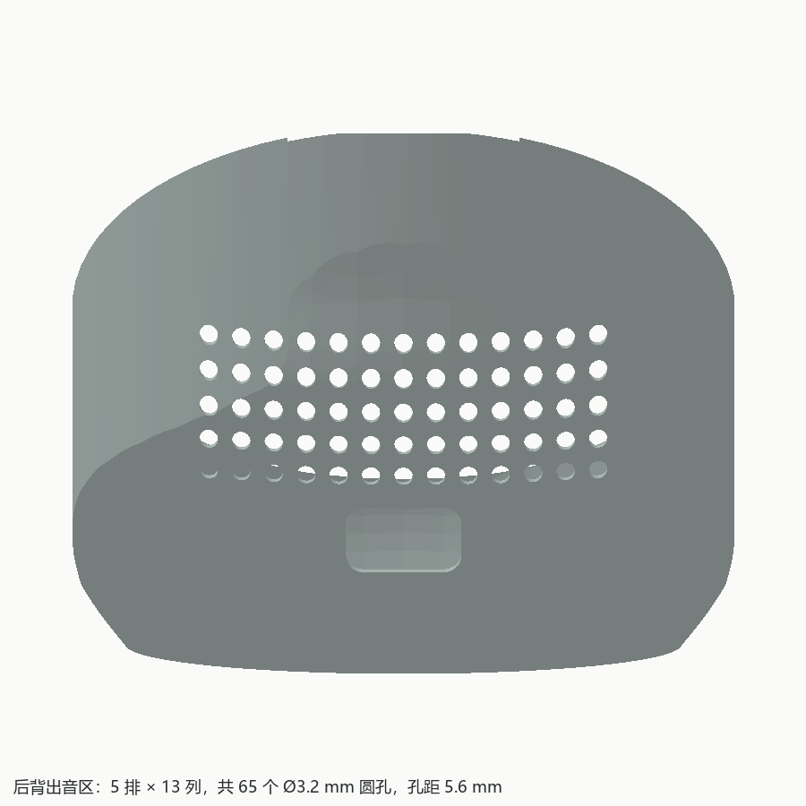
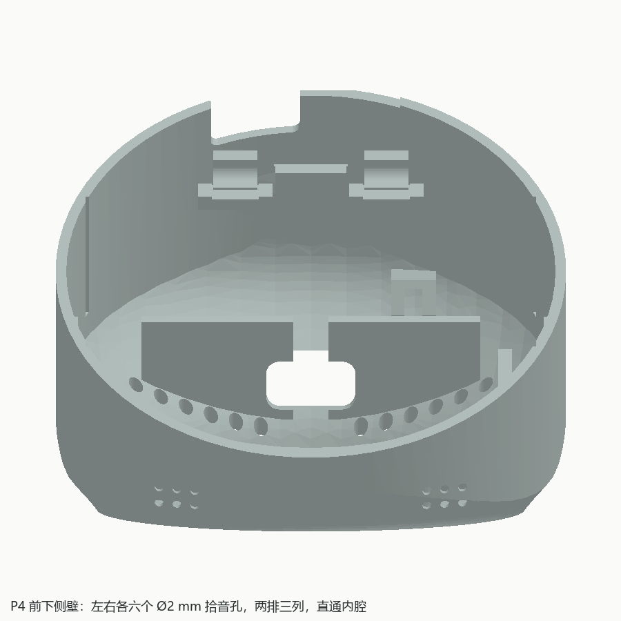

# 微雪 ESP32-P4-WIFI6-Touch-LCD-3.4C 两件式桌面外壳

适配 [微雪 ESP32-P4-WIFI6-Touch-LCD-3.4C](https://www.waveshare.net/shop/ESP32-P4-WIFI6-Touch-LCD-3.4C.htm)，屏幕相对桌面 40°，保留原厂保护板。承托架固定模块，连续后盖包覆外圈，喇叭独立固定在后盖上，拆盖时随盖取下。

**正式工程为 [output/enclosure.FCStd](output/enclosure.FCStd)，后盖改为上侧双刚性钩＋下侧两螺丝；保留原板 M2.5 固定方式、65 个出音孔和左右各六拾音孔。实际仍只打印下面两个部件；旧输出及刷新前文档保存在 `archive/output_backups/`。**

预览：[后背出音圆孔](output/preview_speaker_grille.png)、[喇叭独立固定](output/preview_speaker_mount.png)、[后盖内部](output/preview_cover_inside.png)、[正面隐藏](output/preview_front.png)、[翻开拆盖](output/preview_opening.png)、[装配爆炸图](output/preview_exploded.png)。

## 文件用途

实际只打印 **2 件**，不打印开发板、喇叭或紧固件参考体。

| 文件 | 用途 | 打印方向 |
| --- | --- | --- |
| `main_shell.stl` | 内藏承托架，复用原板四处 M2.5 固定点，两处普通 M3 螺母锁盖 | 后侧框架平面朝下，局部支撑 |
| `rear_cover.stl` | 连续后盖、喇叭四支座、65 孔出音区及 12 孔拾音区和背部出线孔 | 底面朝下，局部支撑 |
| `enclosure.step` | 上述两打印件的装配文件 | 装配姿态不等于打印姿态 |
| `enclosure.FCStd` | 完整 FreeCAD 工程，含隐藏的原厂模块、喇叭和紧固件参考体 | 用于检查装配 |

正式入口为 `output/enclosure.FCStd`；两个 STL 也以正式 `output/` 为准，不能混用归档模型和其他批次报告。

后盖另提供 [rear_cover_print.3mf](output/rear_cover_print.3mf)，在 Bambu Studio 中载入同一后盖以及十二个拾音孔和六十五个出音孔的禁支撑区域。出音孔采用各孔附近的窄 XY 投影向上延伸，防止上方接触区生成的支撑柱穿孔；喇叭四座下缘另设四处局部强制支撑，保留主体其他区域所需的承托。两类修改器均不打印，不增加部件数量。此文件不含打印机、材料预设或 G-code，请选择自己的机型与材料并启用主体支撑。其他切片软件的元数据兼容性未验证；使用 STL 时，需要手动设置声孔禁支撑及喇叭座强制支撑。

## 开发板与后盖固定

拆下原板四颗 M2.5 螺丝，保留原螺纹支柱和保护板，将承托架安装耳叠在原安装面上，改用 **4 颗 M2.5×6 内六角圆柱头螺丝**，头径≤4.7 mm、头高≤2.5 mm。安装耳承压厚 2 mm，通孔 Ø2.9 mm，头部操作孔 Ø5.3 mm；安装耳与框架之间通过 8 mm 宽筋连接。

四孔以原厂 STEP 为准，在模型局部平面坐标中为 `(39.25,-10)`、`(39.25,17)`、`(-39.25,17)`、`(-39.25,-17)` mm，是不对称布局。取消原外围 M4 固定座、头部避让及后盖凸包；两打印件最大正面投影 Ø114.4 mm，由 Ø115 mm 模块完全遮住，不允许局部外露。后盖外圈连续，承托架与后盖普通圆柱区径向间隙 0.5 mm。

安装面在 n=15.1 mm、承压面在 n=17.1 mm，M2.5×6 的尖端仍处于原厂模型 n=11.1 mm，预计入牙约 2 mm，不比原螺丝更深。这里不沿用旧 M4 的 3.5 mm 孔深或 3 mm 入牙参数。首次装配核对原螺丝和支柱实际有效长度，不能强行顶底。

后盖上侧左右各一个刚性挂钩，承托架带一体横销；下侧仍由两颗螺丝锁紧。上钩阻止螺丝对侧直接翘开，不靠薄弹片或配合摩擦。钩中心约为局部坐标 `(±16.93,46.52,24)` mm，名义钩宽 10 mm、承力根厚 3 mm、横销 Ø4 mm、配合间隙 0.30 mm。四处 3×4 mm 止挡承压，喇叭不承担合盖压力。

挂钩采用沿前口上缘转动的圆弧导槽。原三处直插定位舌取消，承托架外环后段缩短，让连续前口有翻开空间；横销两端支柱在前环处加长连接，避开内部 USB 插头。不能沿用旧版的直线套入方式，也不要强掰钩口。两件都已改变，**承托架与后盖必须成套重打，不能与旧版混装**。

导槽入口前翼带渐变加强筋，独立截线采样最薄约 2.35 mm；支柱承压垫各约 12 mm²，承托架后侧落床面积约 337 mm²。这些是几何和打印检查结果，不是极限承载数据。槽内支撑从前口清理，先用计划采用的材料试印配合样件。

后盖用 **2 颗 M3×16 和 2 颗普通 M3 六角螺母**锁紧，从底面中央工具井操作。螺母对边 5.5 mm、厚 2.4 mm；袋对边 6.0 mm、轴向深 2.8 mm、侧入口宽 6.2 mm、承压肩 2.4 mm。不需要热熔螺母。

## 喇叭固定

**100×45×21 mm 是包含四耳的总外形**，孔距沿用 90×36 mm。耳厚 2 mm，位于厚度正中，中心距前面 10.5 mm，两耳面分别为 9.5/11.5 mm。耳孔 Ø6 mm；“外径比内径大 3 mm”按直径差解释为耳外径 Ø9 mm、单边肉厚 1.5 mm。

后盖四处支座直接承托耳面。定位台阶 Ø5.6 mm、突出 1.6 mm，端部导向，中央通孔 Ø3.4 mm。每处使用 **M3×8 螺丝、外径 Ø9／内径 Ø3.4／厚 0.5 mm 垫片及普通 M3 螺母**。垫片压耳面，螺母从后侧放入 6.0×6.8 mm 防转袋，锁紧后捕获；螺母名义对边 5.5 mm、厚 2.4 mm，前承压肩 2.4 mm。袋宽小于螺母约 6.35 mm 的对角尺寸，限制连续转动；须试印确认打印公差。座体后方扩径并用斜筋连接壳壁。

真实箱体在耳根处的形状未知。参考体由总外形扣除四个耳周半径 **7 mm** 的安装操作区，再加已确认的中部圆耳组成；这不代表实物一定存在该空位。耳后扩径座及工具空间必须用局部样件检查是否顶到箱体。报告标记 `speaker_body_shape_verified=false`，不把条件包络检查说成真实箱体已验证。

旧承托架喇叭柱、承托面、低止挡、合盖压耳及软垫均取消，喇叭单独锁在后盖上。

## 装配和拆卸

1. 先试印归档里的孔径、`module_m25_mount.stl`、锁盖螺母袋、`upper_hook.stl`／`upper_hook_socket.stl` 及 `speaker_mount.stl` 局部样件；样件不计入整机两个打印件。清除钩槽和销周支撑，检查圆弧导槽能顺畅装拆。
2. 清理承托架支撑，将两颗锁盖 M3 螺母滑入袋底。拆下原板四颗 M2.5 螺丝，保持保护板及支柱原位，放上承托架，用四颗 M2.5×6 交替轻锁；此时暂不装喇叭及后盖，便于操作。
3. 将四颗喇叭螺母从后盖支座背侧放入防转袋，可用镊子辅助；喇叭耳孔套上台阶，从朝模块的一侧装垫片及 M3×8，交替轻拧。不要压弯薄耳。
4. 线束穿过背孔，接好喇叭和模块，留开盖维护余量，按需扎带固定。
5. 下侧保持约 18°张开，让上侧两个钩槽同时接入横销；沿圆弧导向缓慢合上下侧，四处止挡到位后交替锁紧两颗 M3×16。禁止靠螺丝强行拉合未对齐的挂钩。
6. 拆卸时完全卸下两颗锁盖螺丝，托住后盖、抬开下侧约 18°，使上钩脱离横销，再向后取下；喇叭随盖移动。维护线束须留出翻开和取下余量，再断开接头。单独拆喇叭时卸四颗 M3×8，收好垫片和螺母。

装拆检查采用真实圆弧翻开＋后拉路径，包含随盖运动的喇叭及紧固件，并对完整原厂模块采用精确实体与保守包络检查。逐面精确旋转／拉伸扫掠覆盖连续边界；切向退化面则用中点净距大于区间最大位移的距离界证明。四处闭合接触垫另验证翻开时单调离开承压面。这些检查不代表已经完成实物装配、承载或反复拆装试验；首次应先试印上钩配合样件。

## 打印和其他结构

底面为 96×84 mm 椭圆，中心后移 25 mm；中央 86×74 mm 浅凹 0.6 mm，保留名义 5 mm 连续接触带及最薄 2 mm 中央底板。背部唯一出线孔为 20×12 mm、R3，不再逐一给侧面 USB 开孔。后背格栅出音；一体扎带桥入口约 3.8×1.8×5.8 mm，先试装宽 2.5 mm、厚不超过 1.2 mm 的细扎带。

主供电采用 USB；板上电池口用于 RTC，不能据此接主供电电池。扬声器朝向和声学效果仍待实物检查。

## 后背圆孔出音区

采用 **5 排 × 13 列，共 65 个 Ø3.2 mm 圆孔**，横纵中心距 5.6 mm，名义孔间净筋 2.4 mm。世界坐标 x＝−33.6～33.6 mm、左右居中；五排孔中心离桌高度为 36、41.6、47.2、52.8、58.4 mm。名义圆孔面积合计约 522.8 mm²，不等于实测声学有效面积。

取消旧的 13 条沿屏幕后方向下延伸的长槽及内部凹槽；旧槽在底部附近，不能将刀具数量视为有效后壁开孔数量。新孔沿世界 Y 轴只贯通后侧壳壁，逐孔检查内端进入原有内腔、外端通向外界，避免贯穿前壁、底板或固定座。出线孔、完整底环、喇叭四支座和前下侧壁拾音孔保留。

这是共腔出音结构，未增加导音管或独立网罩。喇叭真实发声面朝向尚未确认，孔道贯通不表示已验证频响、音量或回声。打印后清理孔口及附近支撑，再装机试听。

## 麦克风拾音孔

拾音孔只加在 **P4 后盖**，S3 工程保持无拾音孔。后盖前下侧壁靠底座处，左右各六个 Ø2 mm 圆孔，每侧两排、每排三孔，左右镜像，横纵中心距均为 4 mm、孔间净筋 2 mm。右侧两排均为 x＝26、30、34 mm，下排 z＝6 mm、上排 z＝10 mm，左侧 x 取反；z 是装配后离桌高度。

孔沿世界 +Y 向后进入原有连通内腔，只切穿第一段前侧材料，不贯穿后壁；避开原厂模块、承托架、喇叭、紧固件和线束参考包络。最低孔底至 2.6 mm 底板上平面约 2.4 mm，完整 5 mm 底环不受影响。直孔便于检查和清理毛丝；普通壳壁及孔边承力材料仍按原有标准检查。

默认自动支撑可能进入小孔，因此后盖 3MF 添加局部禁支撑区域，主体继续使用原有普通自动支撑，不能为避免堵孔而关闭整件内部支撑。参考切片分别检查孔边实体和孔芯空隙：开孔前壳壁内部的孔道采样点不得被本体或支撑覆盖；壳外及内腔孔口周边的支撑另列报告，打印后须清理并逐孔确认透光、通气。孔口外部支撑的实际拆除便利性仍需试印验证。

这是左右两个麦克风的**共腔进音口**，不增加独立导音管或其他打印件。原厂麦克风精确声口坐标尚未确认，检查孔道进入内腔不等于已经直对两个拾音口；原板保护结构的实际声路、拾音距离、左右一致性与扬声器播放回声仍须装机试听。安装时不得用胶带、线材或其他新增物遮住原有麦克风口。

按 0.4 mm 喷嘴、0.2 mm 层高、4 道壁、5 mm 外沿设计。参考 Prusa MK3S 0.4，Classic 墙、普通自动支撑、45°阈值；承托架参考 PLA 顶部支撑间隙 0.20 mm、PETG 0.24 mm。两件均需局部支撑。普通壁名义 2.4 mm，承力壁目标至少 1.6 mm、其他功能实体目标至少 1.2 mm；导角和斜面收尖另行检查，不能当成全模型法向最薄壁结论。

圆孔版后盖参考切片采用 **PLA/PETG 顶部支撑间隙均为 0.10 mm**，3 层顶部支撑界面、界面线间距 0 mm、支撑与本体 XY 间隙 0.20 mm，以承托喇叭座下缘。3MF 不携带这些工艺预设，导入后须在自己的机型下配置并复查。较密界面及较小支撑间隙可能增加粘连和拆除难度，尤其 PETG 须先局部试印确认，不能把切片通过当作实物支撑已容易拆除。较大顶部间隙的参考切片曾出现喇叭座下缘长墙段缺少近层承托，因此不能随意增大间隙后直接沿用本次验收结论。

## 参数和验证

`enclosure.py` 是唯一建模源，顶部集中定义模块螺丝、总外形、耳部、孔距、台阶及螺母座参数，方便后续按实物修改。尺寸变化后重跑装配、壁厚和切片检查。

拾音孔参数为 `MIC_HOLE_DIAMETER=2`、`MIC_HOLE_GROUP_X=30`、`MIC_HOLE_BASE_Z=6`、`MIC_HOLE_PITCH=4`、`MIC_HOLE_ROWS=2`、`MIC_HOLE_COLUMNS=3`，左右镜像自动生成；`MIC_HOLE_MIN_WEB=1.6` 是允许的最小净筋。`slice_project.py` 从正式 STL 和同次孔位报告生成切片几何，仅添加非打印禁支撑区域，打印模型仍来自唯一建模源。

出音区参数为 `GRILLE_HOLE_DIAMETER=3.2`、`GRILLE_PITCH=5.6`、`GRILLE_ROWS=5`、`GRILLE_COLUMNS=13`、`GRILLE_BASE_Z=36`，可按实物修改；行列数、孔径或位置改变后须重新验证剩余材料、内腔连通和切片承托。

模型检查包含两件有效单实体、封闭单网格、STEP 重导入两实体、原厂保留实体干涉、插头线束、螺丝承压与装入、耳面承压、螺母装入及工具通道。原厂 STEP 共 1165 实体，只按孔位和形状识别移除四颗原螺丝，剩余 1161 实体全部保留检查，支柱和保护板不屏蔽。后盖、喇叭和紧固件一起移动，核验 0～64 mm 的 11 个开盖位置；底环检查 72 方位和 288 个宽度采样。正面同时执行全轮廓投影和预览像素遮挡检查。

`verify_fit.py` 只读检查实体壁厚、四耳承压环、槽背、喇叭耳座及螺母袋壁。`print_audit.py` 对照 STL 中层截面和实际 G-code，功能覆盖要求 95%，定位槽背另检至少两道墙线，连续无下层搭接墙段不得超过 4.1 mm；收尖边单列并保留原始覆盖率。包围框略大时只用中心校准平移，并要求三高度墙线匹配超过 95%，不缩放 STL。

切片报告绑定 STL SHA-256，G-code 仅本地缓存，不交付未知机型直接打印。打印精度、支撑拆除、真实箱体耳根避让、螺丝头高、触屏稳定性、出线拉力和声学效果都需要实物验证。

本轮后盖重新验证 PLA/PETG，分别检查十二处拾音孔和六十五处出音孔的功能区、孔边实体和孔芯空隙；承托架几何未变时，沿用与同一 STL SHA-256 绑定的已通过报告。后盖切片报告同时绑定实际切片输入 3MF 的 SHA-256；参考切片通过不等于实物支撑已验证容易拆除。

两类声孔分别记录孔边本体覆盖率、真实孔道堵塞和孔口周边支撑；这些是离散切片检查，打印后仍须清理孔口并实物确认通畅。承托架 STL 与此前正式文件完全一致时，本轮仅需重打后盖。

PLA/PETG 均须重新检查两件的真实切片，新增上钩、承力根、横销及端柱功能区；功能截面覆盖率保持 ≥95%、连续无近层承托墙段保持 ≤4.1 mm，不因新结构而放宽。孔道仍检查本体与支撑是否堵塞，孔外支撑必须清除。具体结果与 STL 哈希绑定，见 `output/*_print_validation.json`。本轮两个 STL 都改变，须成套重打。

模块四处螺丝头实际承压各约 10.74 mm²（目标≥8 mm²），喇叭耳面承压各约 35.34 mm²。架背落床面积约 725.69 mm²；普通区、喇叭角、顶部收平边缘的离散径向截线最小值约 2.008／1.709／1.566 mm。喇叭防转袋外围名义最小径向材料约 2.066 mm；这些数字是指定截线和参数检查，不代表全模型法向最薄壁或极限强度。

用 `P4_OUTPUT_DIR`、`P4_CACHE_DIR`、`P4_FIT_DIR`、`P4_PRINT_CACHE_DIR` 指定候选输出、预览网格、试装件及切片缓存。几何生成后运行 `verify_fit.py`、`render_previews.py`，以及 `verify_print.py --part main_shell/rear_cover --material PLA/PETG` 的四个组合；回归运行 `py -3.10 -m unittest test_print_audit`。

发布时按根 `AGENT.md` 检查未保存内容和覆盖授权，备份此前输出，同步 FCStd、STEP、两个 STL、预览、`validation.json`、`fit_validation.json`、`print_features.json` 及四份材料切片报告。复用同一 FreeCAD 文档，刷新后核对完整路径，不新增对比标签。
