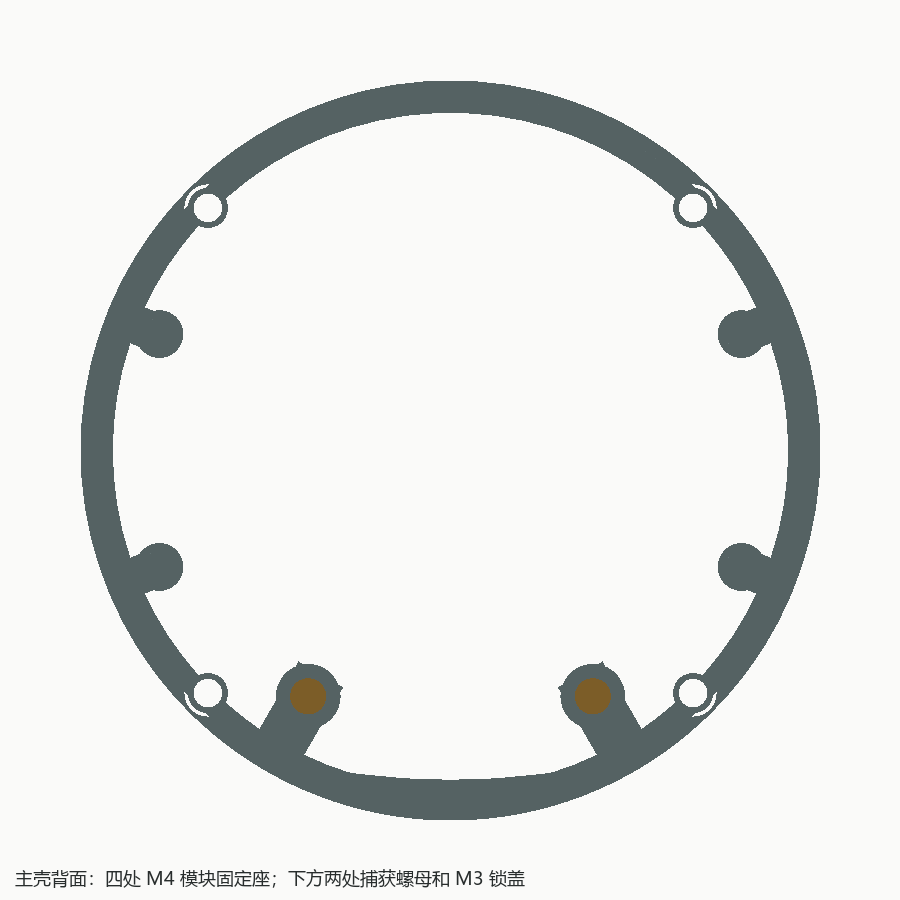
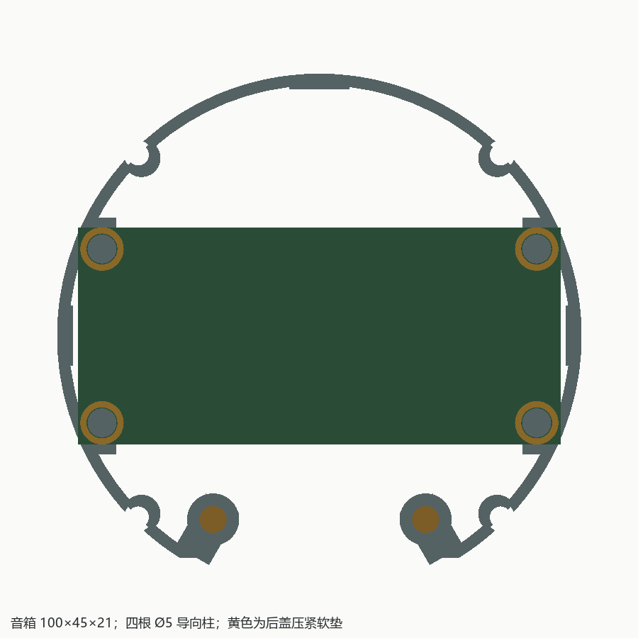
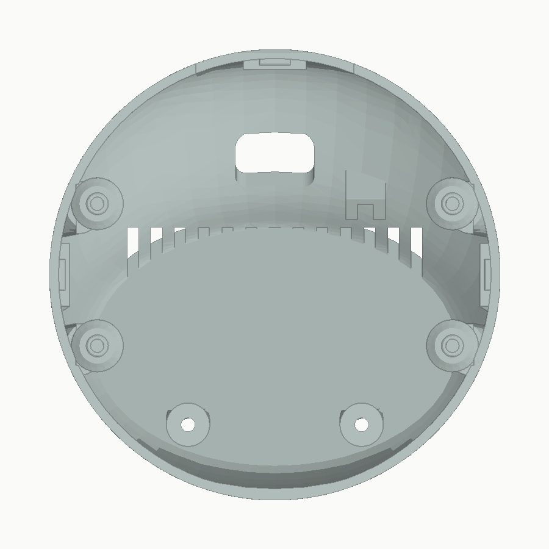
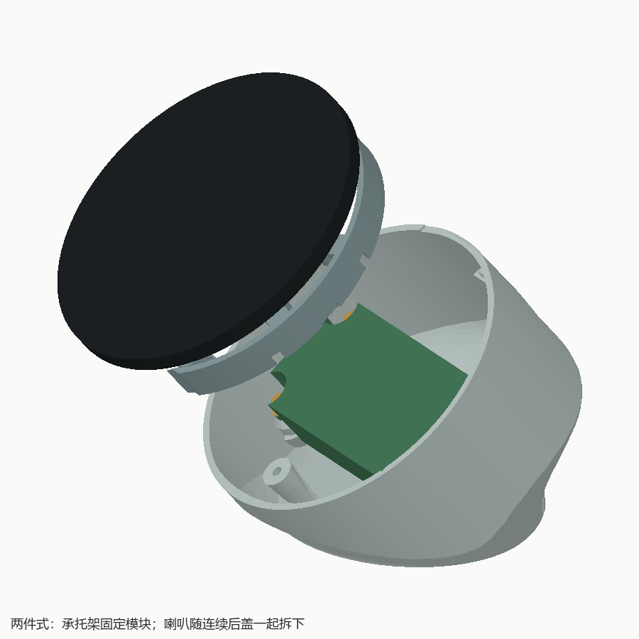

# 微雪 ESP32-P4-WIFI6-Touch-LCD-3.4C 两件式桌面外壳

适配 [微雪 ESP32-P4-WIFI6-Touch-LCD-3.4C](https://www.waveshare.net/shop/ESP32-P4-WIFI6-Touch-LCD-3.4C.htm)。屏幕相对桌面 40°，保留原厂保护板、100×45×21 mm 音箱盒；正视时打印件隐藏于 Ø115 mm 模块后方，打印件最大投影 Ø114.4 mm。

**本轮打印适配审阅：模型、预览和报告在 `archive/print_review/delivery/`，局部试装件在 `archive/print_review/fit_samples/`。正式 `output/` 保留，未提交；覆盖正式输出须用户同意。下方 `output/` 图片在发布前仍为原模型。**

## 两个打印件

| 文件 | 结构与固定 | STL 打印姿态 |
| --- | --- | --- |
| `main_shell.stl` 内藏承托架 | 四颗缩小头 M4 固定模块，四柱定位音箱，两处捕获 M3 螺母 | 后侧框架平面朝下，局部支撑 |
| `rear_cover.stl` 连续外圈后盖 | 一体包到模块背沿，三处定位舌/止挡，两颗 M3×16 锁盖，四处软垫压耳 | 底面朝下，局部支撑 |

外圈全部属于后盖，取消原侧面环形拼缝。承托架圆柱外缘与后盖内壁名义间隙 0.5 mm，下端开口让开底板过渡。后盖沿屏幕法线套入；左、右、上三处定位舌在后盖上，承托架配槽，嵌合 3 mm、单边及端部间隙均 0.30 mm，入口 0.6 mm 导向，落床配合边约 0.3 mm 象脚避让。槽顶采用三角拱，消除原 8.6 mm 平顶跨空。三处独立刚性止挡承受锁盖力，避免螺丝过压音箱。

两颗 M3 位于屏幕坐标 `(±22, −38)` mm；从底面中央工具井操作。普通六角螺母从内侧滑入袋，不需要热熔嵌件。螺母参考对边 5.5 mm、厚 2.4 mm；袋对边 6.0 mm、深 2.8 mm，入口宽 6.2 mm，后方实体承压肩 2.4 mm，袋顶改为斜拱。M3/M4 通孔为 Ø3.4/4.4 mm，实际公差先用试装件确认。

底面为 96×84 mm 椭圆，中心后移 25 mm；中央 86×74 mm 浅凹 0.6 mm，名义 5 mm 连续接触带、中央底板最薄 2 mm，工具井避开接触带。




## 喇叭固定和装配

四根 Ø5×4 mm 定位柱属于承托架，柱端有 0.6 mm 导向；四处 Ø9 mm 承托面接触安装耳，低位止挡帮助放置。后盖四处 Ø9 mm 压耳与定位柱同轴、中心让空，并用斜筋连接壳壁。压耳贴 0.5 mm 环形软垫，暂按压缩至 0.2 mm 设计，软垫内径建议 6.4 mm。三处独立止挡限定最终合盖位置。

耳厚尚未单测，先按 21 mm 参数化；音箱参考为完整长方体减四孔，实际耳形、振膜和端子未知。压耳只允许压安装耳。若耳厚小于整箱厚，必须同时核对真实耳形及压耳周围箱体，不能只改耳厚后直接打印。开盖后需托住喇叭，定位柱不提供倒置防脱。

1. 先试印 `archive/print_review/fit_samples/` 的螺母袋、定位舌/槽、喇叭定位柱、压耳、M4 开口座及孔径样件。样件不计入整机两个打印件。
2. 将两颗 M3 六角螺母滑入承托架，确认到底且不能转动。
3. 用四颗 **M4×16 缩小头螺丝，头径≤5.5 mm、头高≤3 mm** 固定模块，孔距 75×75 mm。预计入牙约 2 mm，必须实测有效牙深，避免顶穿。该头型是待确认采购规格，普通 Ø7 mm M4 圆柱头不能替代。此时先不装喇叭，以便操作 M4。
4. 线穿过后盖背孔，接好模块并留维护余量；将喇叭四孔套上定位柱，接线，给后盖四压耳贴软垫。
5. 整理线束，沿轴向套入后盖定位舌，交替轻拧两颗 M3×16。三处止挡到位即停，不用螺丝强行矫正不匹配的耳厚。
6. 拆卸时抬起或翻转设备，卸两颗 M3，沿屏幕法线向后拉开后盖，同时托住喇叭。





## 接线和出音

侧面 USB、SD、BOOT/RESET 不开窗口，拆盖维护。背面统一 **20×12 mm、R3 出线孔**，内部接线后穿出；内侧 Type-C UART 口约 13×15×9 mm 插头预留，背孔旁有扎带桥。线径 Ø3.5 mm 的参考通路通过空间检查，真实插头和线材弯曲半径仍须实测。

主供电采用 USB；板上电池口用于 RTC，不能据此接主供电电池。后背中央有出音格栅，扬声器朝向、覆盖和效果须试装；尚无已验证的专用麦克风声道。

出线孔旁的一体扎带桥向壳内延伸，穿入口验证净空为 3.8×1.8×5.8 mm，建议先用宽 2.5 mm、厚不超过 1.2 mm 的细扎带试装。桥下仍允许局部支撑，打印后先清理穿入口再穿线束扎带。

## 承托架局部加固

四处 M4 改为朝外开口的偏心固定座，取消原外侧 0.7 mm 薄圈。半径 3.925 mm、向圆心偏移 0.975 mm，孔位不变，向内名义材料 2.7 mm；开口端切向名义材料约 1.60 mm，实体截线下限约 1.50 mm。每处小头螺丝保留约 4.28 mm² 承压面。开口座需要先试印确认抗裂和锁紧效果，不作为闭孔柱使用。

三处定位槽背部局部宽 12.5 mm、内缘半径 51 mm，槽背径向材料 1.8 mm，并向前延长以包住拱顶。喇叭承托面及低止挡底座 2.4 mm，连接斜筋宽 8 mm。后盖止挡、压耳和 M3 座按后盖实际打印方向设置向下斜撑；压耳中心仅前凹 0.6 mm，保留至少 1.2 mm 实心顶。后盖下部侧后曲面放缓外扩，底面尺寸和完整名义 5 mm 接触带保留；最高处收平并让开前口薄楔。

顶部 `M4_REINFORCE_R/OFFSET`、`FRAME_R`、`LOCATOR_BACK_INNER_R/WIDTH`、`SPEAKER_BASE_T`、`SPEAKER_RIB_WIDTH` 控制加固尺寸。`verify_fit.py` 检查生成实体的固定座 48 条实心截线、三个槽背、四个承托面、压耳盲孔实心顶，以及扎带桥和穿入口；这些检查验证几何连续性，不是有限元分析或实物载荷验证。首次试印仍需检查锁紧开裂、触屏晃动和反复拆装后的松动。

## 参数和打印

`enclosure.py` 为唯一建模源。顶部 `SPEAKER_W/H/T` 为音箱 100×45×21 mm；`HOLE_X/S` 为半孔距 45/18 mm，采用用户长短边孔距 90×36 mm，不按约 102 mm 对角值反算。`PIN_R/H`、`PIN_LEAD_H`、`SPEAKER_EAR_T`、`PRESSURE_R`、`PAD_T`、`PAD_COMPRESSED_T` 集中定义柱、耳厚、压耳和软垫。尺寸变化后必须重跑装配、薄壁和切片检查，框架及低止挡位置也需复核，不保证任意音箱尺寸仍适配当前外形。

按 0.4 mm 喷嘴、0.2 mm 层高、4 道壁、5 mm 外沿设计，PLA/PETG 使用同一套几何、分别选择材料配置。普通壁名义 2.4 mm，承力筋/孔座/槽背目标至少 1.6 mm，其余功能实体目标至少 1.2 mm；孔口、开口端及斜面收尖另检，不能把这些目标当成全模型法向最薄壁结论。

使用 STL 导出摆放：承托架后侧框架落床，后盖底面落床。参考机型 Prusa MK3S 0.4，普通自动支撑、45°阈值；PLA 顶部支撑间隙 0.20 mm，PETG 0.24 mm。底面浅凹、局部前口及附件仍允许少量支撑；取出路径和粘连需试印确认。报告绑定 STL SHA-256，参考 G-code 仅本地归档，不直接交付未知机型打印。

`print_audit.py` 对照 STL 功能截面和实际挤出路径：完整截面覆盖要求 95%，M4 内侧和定位槽背部另检至少两道墙线；当前墙线与下层本体/支撑足迹搭接，连续无搭接段限 4.1 mm。倾斜圆面起止层的不足 1.2 mm 收尖边单列，同时保留完整轮廓原始覆盖率，不能将收尖分类解读为所有边缘尺寸完全复现。`test_print_audit.py` 用漏打方柱、悬空墙和正常斜壁搭接等案例验证核验器。

本轮 PLA/PETG 四次切片通过，承托架/后盖本体分别 99/459 层，最长连续无下层搭接墙段约 1.81 mm。相比加固审阅模型，同配置两件合计支撑挤出体积：PLA 从 12.078 降至 10.797 cm³（减少 10.6%），PETG 从 11.601 降至 10.411 cm³（减少 10.3%），详见 `print_comparison.json`。支撑降低不代表实物可拆性或材料强度已经验证。


## 生成和验证

```powershell
& 'D:\Program\FreeCAD 1.1\bin\freecadcmd.exe' -u archive/build_user.cfg -s archive/build_system.cfg enclosure.py
& 'D:\Program\FreeCAD 1.1\bin\freecadcmd.exe' -u archive/fit_user.cfg -s archive/fit_system.cfg verify_fit.py
py -3.10 render_previews.py
py -3.10 verify_print.py --part main_shell --material PLA
py -3.10 verify_print.py --part rear_cover --material PLA
py -3.10 verify_print.py --part main_shell --material PETG
py -3.10 verify_print.py --part rear_cover --material PETG
py -3.10 -m unittest test_print_audit.py
```

重建覆盖固定名称输出并涉及 FreeCAD 刷新，执行前须按根 `AGENT.md` 确认覆盖和未保存状态。审阅时可用 `P4_OUTPUT_DIR`、`P4_CACHE_DIR`、`P4_FIT_DIR`、`P4_PRINT_CACHE_DIR` 分别指定归档区的输出、预览网格、试装件及切片缓存，并另开文档保留原窗口。

交付 FCStd、仅含两打印实体的 STEP、两个 STL、预览、`validation.json`、`fit_validation.json`、`print_features.json`，以及两件分别对应 PLA/PETG 的四份 `*_pla_print_validation.json` / `*_petg_print_validation.json`。FCStd 另有完整原厂模块、音箱、软垫、插头/走线和紧固件参考体，不混入正式 STL/STEP。

几何验证覆盖两件各有效单实体、STL 封闭单网格、STEP 重导入两实体；完整原厂 1165 实体及音箱、插头、线束干涉；工具轴线、螺母滑入、0～64 mm 的 11 个合盖位置、正面隐藏、72 方位及 288 个底环宽度采样。三处止挡有效接触各约 15.8 mm²、四处软垫各约 31.4 mm²。

前圈九个轴向截面、共 391 条有效径向样本：普通区最小约 2.075 mm、M4 头部约 1.217 mm、音箱角约 1.709 mm、顶部收平边缘约 1.566 mm。各组使用不同门槛，详情见 `fit_validation.json`。径向采样不代表全局法向最薄壁；格栅、压耳、定位舌和锁盖座另做功能切片检查。

质量和倾覆角按模块 220 g、音箱 100 g、PETG 1.27 g/cm³ 估算，见报告。螺丝采购/牙深、实际耳厚/耳形、软垫压紧、打印公差、支撑拆除、触屏载荷、出线拉力和声学效果均未做实物验证。
