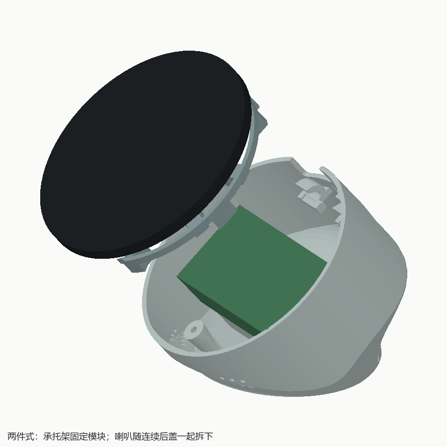

# 微雪 ESP32-P4-WIFI6-Touch-LCD-3.4C 两件式桌面外壳

适配[微雪 ESP32-P4-WIFI6-Touch-LCD-3.4C](https://www.waveshare.net/shop/ESP32-P4-WIFI6-Touch-LCD-3.4C.htm)，屏幕相对桌面40°，保留原厂保护板，正面打印件隐藏在 Ø115 mm 模块轮廓内。承托架固定模块，连续后盖包覆外圈；喇叭贴在后盖内侧，随盖拆下。

正式工程为 [output/enclosure.FCStd](output/enclosure.FCStd)。喇叭采用边框泡棉双面胶，斜出音孔对齐双振膜面；本次在板上Type-C对应的后盖位置增加直插开口。实际仍只打印两件，本次只需重打后盖，已有双钩热熔螺母版承托架保持不变。

## 文件与打印

| 文件 | 用途 | 打印方向 |
| --- | --- | --- |
| `main_shell.stl` | 内藏承托架，四处原板M2.5固定，两处M3热熔螺母锁盖 | 后侧框架平面朝下，局部支撑 |
| `rear_cover.stl` | 连续后盖，含喇叭胶台、斜出音孔、12个拾音孔、Type-C直插口及原出线孔 | 底面朝下，局部支撑 |
| `enclosure.step` | 上述两打印件的装配文件 | 装配姿态不等于打印姿态 |
| `enclosure.FCStd` | 完整工程，含隐藏的模块、喇叭总包络、胶带及紧固件参考体 | 查看装配，不直接打印参考体 |

[rear_cover_print.3mf](output/rear_cover_print.3mf)包含同一后盖和声孔禁支撑区域；修改器不打印，不增加部件数量。斜孔按完整孔道的世界坐标包围范围设置禁支撑，取消旧喇叭四座的强制支撑块。3MF不含机型、材料预设或G-code，须选自己的机型、材料并启用主体支撑；其他软件对修改器的兼容性未验证。用STL切片时须手动设置声孔禁支撑。

参考工艺为0.4 mm喷嘴、0.2 mm层高、4道壁、Classic墙、普通自动支撑45°、5 mm外沿。承托架PLA/PETG顶部支撑间隙分别0.20/0.24 mm；后盖两材料均0.10 mm，3层顶部界面、界面线间距0、支撑与本体XY间隙0.20 mm。较密界面可能更难拆，PETG尤其需试印。参考切片通过不表示实物支撑已验证易拆。

## 喇叭贴胶与朝向

用户确认总外形 **100×45×21 mm，包含四耳**。按完整长方体总包络检查安装，不再挖掉耳孔周围半径7 mm的假设空位，也不再使用耳孔定位柱、螺母袋、垫片或M3×8螺丝。实际箱体凹角不作为放行干涉的依据。

照片中双振膜所在面朝后下方，保留倾斜姿态；用户已确认该取舍。竖直朝后摆放的初步候选与现有承托架干涉，因此本次保留外形和承托架，改为让出音孔轴与发声面法线一致。喇叭沿局部n轴占22.5～43.5 mm；发声面在n=43.5，胶台面在n=44.5。图中深色圆面仅示意双振膜朝向，圆直径、中心距不作为实测尺寸或机械验收依据。

采用装配厚度 **1 mm泡棉双面胶**，只贴硬边框，避开振膜和悬边：

- 长边硬边框宽3 mm，胶带宽2 mm；每边中间留8 mm拆胶入口，两段各34 mm长。
- 短边可贴区域至少5 mm；从100 mm总长两端各内退5 mm，再向内布置3 mm宽、24 mm长胶条，避开四角耳位。
- 共六段胶台，名义贴胶面积416 mm²；胶台前端实体厚度至少2 mm。四个耳朵仅预留空间，不承受夹紧力。
- 完整箱体非粘贴区域预留0.5 mm空间；振膜区域前方保持至少2 mm静态净空，胶台中央开通。

先清理、整平胶台并除尘脱脂；按胶带厂商适用材料和粘贴要求处理。将胶条贴在硬边框，试放并确认朝向、耳位及线束后，再去离型纸压合。勿按压振膜，勿在振膜、悬边或孔区贴胶。实际压缩后的胶厚与1 mm不同时，应修改参数重验。胶粘抗振、长期蠕变和运输牢固度仍需实物验证。

拆喇叭时先取下后盖并断开接头，从长边中央入口用塑料薄片或牙线逐段分离胶层，不拉线、不撬振膜；重新安装更换胶带。不是无损快拆卡扣。

预览：[胶台与箱体](output/preview_speaker_mount.png)、[贴胶位置和发声面](output/preview_speaker_tape.png)、[出音孔](output/preview_speaker_grille.png)、[内部](output/preview_cover_inside.png)、[正面](output/preview_front.png)、[拆盖](output/preview_opening.png)。


## 爆炸图与演示视频



视频与动图由渲染器按需生成本地文件，**不入库**：`output/exploded_view.mp4`（1920×1080 / 30 fps / 10 s）与 `output/exploded_view.gif`（960×540 / 15 fps）。生成方法见 [shared/explode_render/README.md](../../shared/explode_render/README.md)，在仓库根目录执行：

```powershell
& "D:\Program\FreeCAD 1.1\bin\python.exe" projects\waveshare-esp32-p4-wifi6-touch-lcd-3.4c-enclosure\explode.py --mode all
```

从 `enclosure.FCStd` 读取装配位姿，按装配法线错峰展开开发板、M2.5 螺丝、承托架、喇叭、胶层、后盖与 M3 锁紧件，再原路装回。材质为渲染时配色（暖白后盖、石墨承托架、拉丝钢紧固件、橙色胶层、近黑屏幕），不写回 FCStd，参考体不计入打印件数量。

## 后背出音与拾音

出音孔为左右镜像两组、每组9个，共 **18个 Ø3.2 mm** 斜圆孔。局部x/s中心距5.6 mm，名义净筋2.4 mm；三排s=7.2、12.8、18.4 mm，分别只保留 |x|≥39.2、33.6、11.2 mm 的孔，最大 |x|=39.2 mm。由此形成两组渐变排列，中央留空。所有孔轴为世界坐标 `(0, sin40°, -cos40°)`，与喇叭发声面法线一致，孔口在后下过渡弧面。孔数服从完整底板、声路和胶台避让，不沿用原65孔布局。

每孔检查内端接入内腔、外端通向外界、内部零件避让，以及不切入底板及底板上方1.6 mm保护区。名义圆孔截面积合计约144.8 mm²，不等于实测声学有效面积；孔轴倾斜，外观孔口也不一定是正圆。本次几何朝向已按照片和用户确认修正，音量、频响、两个圆面各自作用及播放回声仍须装机试听，不能以孔道贯通代替声学验证。

拾音孔保持P4前下侧壁左右各六个 Ø2 mm孔，每侧两排三列，孔距4 mm、净筋2 mm。右侧x=26/30/34 mm，左侧取反；两排离桌高度z=6/10 mm，沿世界+Y接入共腔，不贯穿后壁。麦克风精确声口位置未确认，保留原板声路，不得用胶带或线材遮住。

声孔参考切片分别检查孔边实体和孔芯空隙，孔道不得被本体或支撑堵塞。孔口周边支撑另列，打印后仍须清理并逐孔确认通气。喇叭和麦克风共腔，未增加独立导音管或其他打印件；S3工程不作修改。

## 开发板、锁盖及装配

拆下原板四颗M2.5螺丝，保留原支柱和保护板；承托架叠在原安装面，用四颗 **M2.5×6内六角圆柱头**固定，头径≤4.7、头高≤2.5 mm。安装耳厚2 mm，通孔 Ø2.9、头部操作孔 Ø5.3，连接筋宽8 mm。四孔局部坐标为 `(39.25,-10)`、`(39.25,17)`、`(-39.25,17)`、`(-39.25,-17)` mm。尖端位置n=11.1与原螺丝一致，预计入牙2 mm，首次核对实物有效长度。

两打印件正面投影最大 Ø114.4 mm，由 Ø115 mm模块遮住；普通圆柱区径向配合间隙0.5 mm。普通壁名义2.4 mm，局部原箱体角位离散径向检查目标≥1.6 mm；不能当作全模型法向最薄壁结论。

上侧双刚性挂钩配承托架一体横销，下侧两颗 **M3×16** 锁盖。钩宽10 mm、根厚3 mm、销 Ø4、间隙0.30 mm；四处3×4 mm止挡承压，喇叭不承担合盖压力。旧直插舌版本不能混装；当前胶粘后盖仍与现有双钩热熔螺母版承托架配套。

承托架锁盖采用 **M3×3×4热熔螺母、Ø3.8 mm直孔**，孔深3.4、入口0.3 mm导角。先从背面热熔至n=26齐平，完全冷却后再装开发板。螺丝完整啮合3 mm，尖端距避空孔底1 mm。锁盖热熔结构不变。

装配顺序：热熔螺母并安装承托架→喇叭试放和贴胶→穿线、连接并留维护余量→下侧张开约18°，让两钩同时接入横销→沿圆弧合盖，止挡到位后交替锁紧两颗M3×16。禁止用螺丝拉合错位挂钩。拆卸时卸两颗锁盖螺丝，下侧翻开约18°，上钩脱离后向后取盖，喇叭随盖移动。

底面仍为96×84 mm椭圆，中心后移25 mm；中央86×74 mm浅凹0.6 mm，完整5 mm接触带不变。中央底板最薄2 mm，普通底板名义2.6 mm。背部出线孔20×12 mm、R3。扎带桥移至声孔上方，底部离桌40 mm，增加向后下方连接壳壁的45°斜撑；穿带槽内侧打通，检查净空3.8×7.8×5.8 mm，使用宽2.5、厚≤1.2 mm细扎带。线束参考同步绕到新扎带位置，实际弯曲半径仍须实物确认。USB为主供电，板上电池口用于RTC，不能据此接主供电电池。

## Type-C直插开口

板上Type-C插拔方向对应的后盖开口为 **20×14 mm、R2圆角、外侧0.5 mm导角**，按加大直头USB线预留；宽高在接口横截面量取，不是世界坐标水平投影。通道沿局部+s方向（世界坐标`(0,cos40°,sin40°)`）通向壳外，横向中心x=-12.4 mm、轴向中心n=12 mm；与后盖前口连通为缺口，避免保留薄唇。切除从s=49.2 mm开始，限制在外壳壁，不削内部挂钩入口加强翼；独立比较内半径54.79 mm以内的结构移除体积为0。保留原背部20×12 mm出线孔，其他线材仍可从原孔引出。

本次只切后盖，承托架不改。用户已通过实物确认承托架与USB线不干涉；保守13×9 mm和20×14 mm插头扫掠在模型中仍与架有交叠，因此仅验收后盖开口贯通，不将其声称为整条插头通道零干涉或所有USB线通用。安装时沿板上接口方向直插，不沿桌面水平硬推，不依靠开孔边缘把力传给板上插座。

尺寸和位置由`USB_ACCESS_WIDTH / HEIGHT / RADIUS / CHAMFER / X / N / START_S / END_S`参数控制。预览：[Type-C后盖开口](output/preview_usb_access.png)。

## 参数与验证

`enclosure.py`是唯一建模源。贴胶参数集中为 `SPEAKER_FRONT_N`、`SPEAKER_CLEARANCE`、`SPEAKER_TAPE_T`、`SPEAKER_LONG_TAPE_W`、`SPEAKER_SHORT_TAPE_W`、`SPEAKER_SHORT_INSET`、`SPEAKER_FACE_CLEARANCE`；胶台位置在 `speaker_pad_rectangles()`。出音孔用 `GRILLE_BASE_S / PITCH / ROWS / COLUMNS / ROW_MIN_X`控制。尺寸变化后重新验证，不直接改STL或FCStd。

检查包含：两件有效单实体、闭合单连通网格及落床、STEP回读两实体、完整总包络及0.5 mm间隙、喇叭轴向装入路径、胶台连续2 mm实体、振膜前方2 mm净空、孔轴对齐、声孔和出线通路、完整底环、正面投影和预览像素遮挡。保留原厂1161实体，只移除识别出的四颗原螺丝；承托架、后盖和完整模块干涉检查，随盖移动的箱体及胶层执行连续开合验证。

`verify_fit.py`独立检查壁厚、胶台、装入路径、振膜净空、模块固定和热熔母座；两处热熔孔各72条径向截线。Type-C另验后盖通道、喇叭避让及六处孔旁余壁截线（≥1.6 mm），入口导角收尖区不计作普通壁厚。`print_audit.py`对照真实G-code，功能截面覆盖率≥95%，连续无近层承托墙段≤4.1 mm，不因贴胶或开口放宽；收尖边单列。两件分别完成PLA/PETG切片报告，均绑定本次STL哈希，后盖另绑定实际3MF哈希。

常规实体有效性和STEP回读不等于严格曲面检查；此前存在 `BOPAlgo_InvalidCurveOnSurface`，本次详细结果保存在本地归档对比记录。打印精度、支撑可拆性、真实胶粘牢固度、线束弯曲及声学仍需实物验证。

候选输出用 `P4_OUTPUT_DIR / P4_CACHE_DIR / P4_FIT_DIR / P4_PRINT_CACHE_DIR`隔离；生成后运行 `verify_fit.py`、`render_previews.py`、`verify_print.py --part main_shell/rear_cover --material PLA/PETG`，以及7项 `test_print_audit`回归。发布前备份旧输出和经授权的窗口内容，刷新并保存同一个正式 `output/enclosure.FCStd`，不新增标签、不自动提交。
