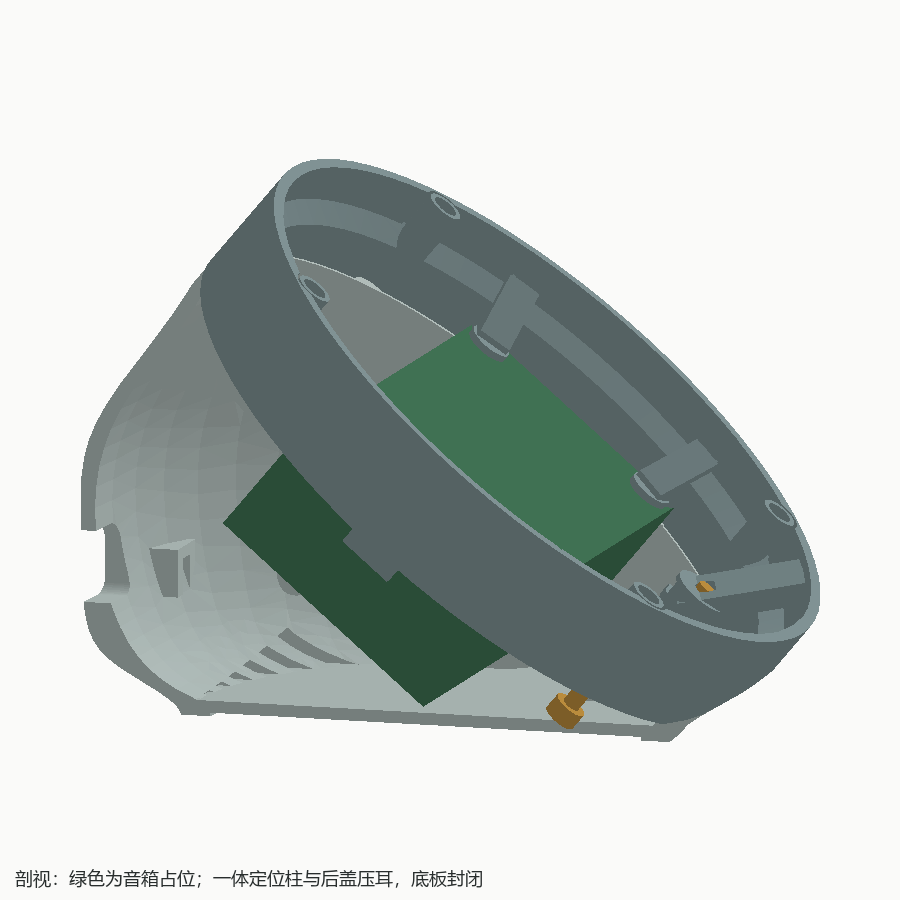
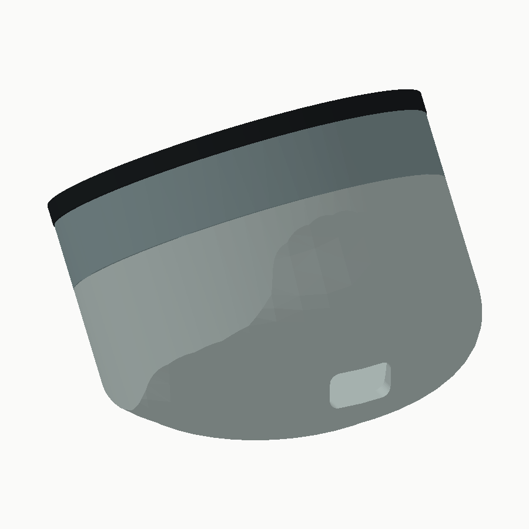
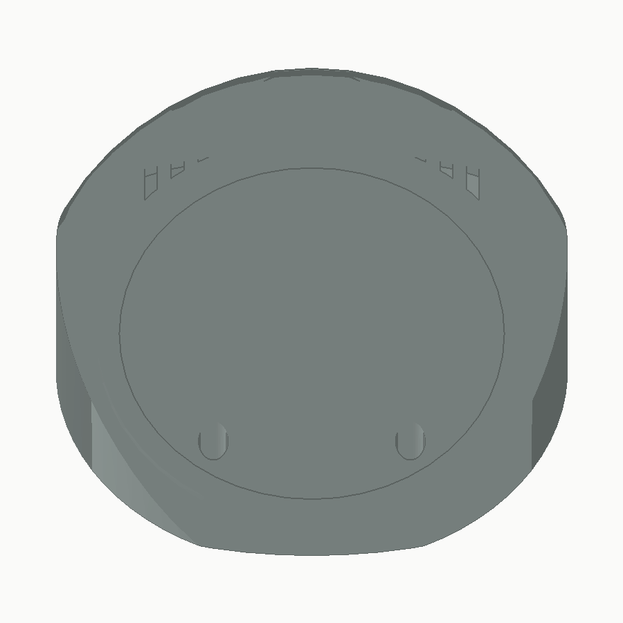

# 微雪 ESP32-P4-WIFI6-Touch-LCD-3.4C 两件式桌面外壳

适配 [微雪 ESP32-P4-WIFI6-Touch-LCD-3.4C](https://www.waveshare.net/shop/ESP32-P4-WIFI6-Touch-LCD-3.4C.htm)。屏幕相对桌面 40°，保留原厂保护板，安装 100×45×21 mm 音箱盒。沿屏幕法线正视时，打印件隐藏在 Ø115 mm 模块后方，打印件最大投影 Ø114.4 mm。

## 两个打印件怎样固定

| 打印件 | 连接方式 | 打印摆放 |
| --- | --- | --- |
| `main_shell.stl` 承托主壳 | 四颗 M4 固定到原模块外围安装孔；一体喇叭承托、四根 Ø5×4 mm 定位柱和三角筋 | 模块贴合面朝下，STL 已落床 |
| `rear_cover.stl` 带底面后盖 | 三处止口定位，两颗 M3×16 锁入主壳捕获螺母；后盖一体压耳固定音箱 | 底面朝下，STL 已落床 |

没有独立安装框、喇叭压条或弹性卡扣。两件沿屏幕法线套合，接缝间隙 0.25 mm，三处局部止口嵌合 3 mm、单边间隙 0.25 mm。止口在左、右、上方，避开音箱四角和底板；旁边三处轴向承压台阶限定合盖位置，避免拧紧螺丝时过度挤压音箱。主要承托采用 45°斜筋，局部圆柱和螺母槽仍须按切片检查支撑。

后盖 M3 位于屏幕坐标 `(±22, −38)` mm。底部中央凹区有贯通操作井，抬起或翻转设备，用直杆内六角扳手拆装；螺丝头深藏在内部，不接触桌面。螺母从开壳内侧滑入六角袋，平面限制旋转，后方 2.4 mm 实体承压肩限制脱出。

底面是 96×84 mm 椭圆，中心后移 25 mm，中央 86×74 mm 浅凹 0.6 mm。保留名义 5 mm 连续接触带，中央底板最薄 2 mm；工具井位于中央凹区。





## 接线和安装顺序

侧面 USB、SD、BOOT/RESET 窗口全部封闭，拆盖维护。背面统一设置 **20×12 mm、R3 圆角出线孔**，内部接好线后从此穿出，不安装面板插座。靠内侧 Type-C UART 口预留约 13×15×9 mm 插头空间；线径 Ø3.5 mm 的折线参考路径避开两壳和音箱。背孔旁有一体扎带桥，用于固定软线；插头尺寸和线材弯曲半径须实测确认。

1. 先试印 `archive/fit_samples/` 的螺母袋和止口试装件。正式 `output/` 只有两个整机 STL。
2. 两颗 M3 六角螺母从主壳内侧滑入槽。螺母对边 5.5 mm、厚 2.4 mm；袋对边 5.7 mm、深 2.6 mm，入口宽 5.8 mm。
3. 用四颗 **M4×16 内六角圆柱头螺丝**固定主壳到模块外围孔，孔距 75×75 mm，保护板保留。头按 Ø7×4 mm 建模；预计进入模块约 2 mm，必须先实测原孔有效牙深，避免顶穿。此时尚未放音箱，四处工具轴线均敞开。
4. 先把电源插头穿过后盖背孔，再接到模块，留适当维护余量。主供电采用 USB；板上电池口为 RTC，不能据此接主供电电池。
5. 音箱四个约 Ø6 mm 孔套上 Ø5 mm 定位柱并接线。后盖四处一体压耳面贴约 0.5 mm 软垫，合盖压至约 0.2 mm；只压安装耳，不压振膜。
6. 整理线束，用扎带桥固定出线。后盖沿轴向套入止口，交替轻拧两颗 **M3×16 内六角圆柱头螺丝**。主壳负责定位，后盖通过软垫压耳，无需另锁压条。
7. 拆卸时抬起或翻转设备，卸两颗 M3，沿屏幕法线向后拉开后盖。托住音箱再取出；开盖后音箱失去压紧，不能仅靠定位柱倒置悬挂。





## 尺寸依据与实物待确认

| 项目 | 依据 |
| --- | --- |
| 原模块 | 用户 PDF/STP：外径 Ø115、显示 Ø87.6 mm；PDF 总厚 15.10、STP 边界占位 15.5 mm |
| 原厂安装孔 | M4，中心 `(±37.5, ±37.5)` mm |
| 音箱盒 | 用户实测 100×45×21 mm，孔距 **90×36 mm**；不用约 102 mm 对角值反算 |
| 音箱孔/柱 | 孔约 Ø6；按用户要求柱 Ø5、高 4 mm |
| 耳部厚度 | 尚未单测，`SPEAKER_EAR_T=21` mm 暂按整箱厚；调整后重新生成后盖压耳 |

音箱使用完整长方体减四孔的保守参考体，实际耳形、振膜和端子位置未知。后背中央保留出音格栅，实际朝向和覆盖须试装确认。没有已验证的专用麦克风声道；麦克风位置须实物对孔，声学隔离和回声表现尚未验证。

保持正面完全隐藏的限制下，M4 头部通道外侧约 **0.52 mm** 径向薄壁；音箱角部让位约 **1.71 mm**，止口槽外侧约 **1.25 mm**。M4 外侧薄皮不作为主承重区，载荷经四个螺丝座、内侧环托及筋传递。这些位置不能按普通 2 mm 壁厚处理，必须检查切片线宽和连续性。要加厚 M4 头外侧壁，需同时改变螺丝头尺寸或允许外形超出当前隐藏轮廓。

## 生成与验证

`enclosure.py` 是唯一建模源，`render_previews.py` 仅渲染缓存。参考资料在 `reference/`。生成缓存、试装件和本地归档位于 `archive/`，不纳入 Git 提交。

```powershell
& 'D:\Program\FreeCAD 1.1\bin\freecadcmd.exe' -u archive/build_user.cfg -s archive/build_system.cfg enclosure.py
py -3.10 render_previews.py
```

交付 `output/enclosure.FCStd`、`output/enclosure.step`、两个 STL、预览和 `output/validation.json`。STEP 仅有两个打印实体；FCStd 还保留完整原厂模块、音箱、插头/走线和紧固件参考体。命令行生成后可在 GUI 调用源中的 `configure_display(doc)` 恢复参考体隐藏显示。

建议 PETG、0.4 mm 喷嘴、0.2 mm 层高、至少 3 道壁。使用导出姿态，切片检查主壳斜托、螺母袋顶面、后盖压耳和工具井的支撑。止口及薄壁先试印，不将几何有效等同于无支撑可打印或实物可靠性验证。

报告检查：两个打印件各单实体且网格封闭、STEP 重导入两实体、两件互不干涉、与完整 1165 实体原厂模型及保守音箱不干涉、紧固件和工具轴线、螺母滑入路径、0～64 mm 的 11 个合盖位置、正面投影、底环 72 方位和 288 个宽度采样。线束只验证空间占位，真实弯曲半径未验证。

稳定性按模块 220 g、音箱 100 g、PETG 密度 1.27 g/cm³ 估算，总质量和倾覆角见报告；未试验触屏推力、线缆拉力和防滑脚垫。螺丝深度、耳厚、软垫压紧、打印公差和麦克风对孔仍须实物确认。
